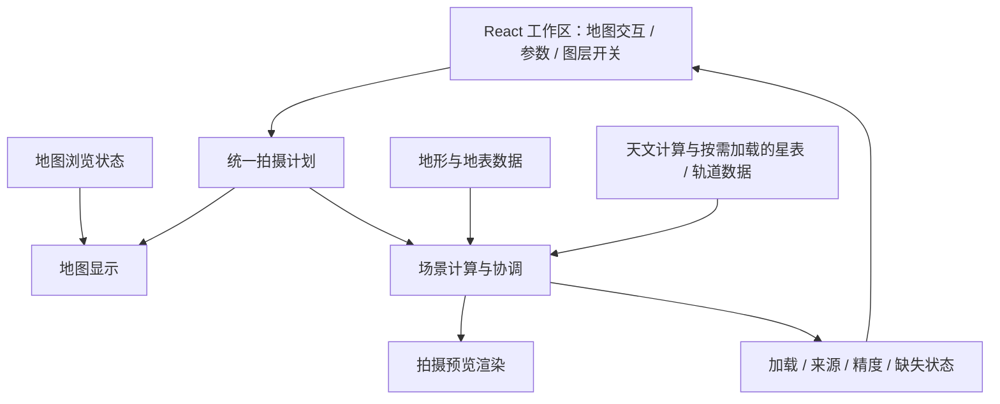

# 全局架构

状态：P2 地形与晴空环境采用 MapLibre；P3 日月采用本地星历、标准折射与共享地形深度的三维图层。更新：2026-11-04。

本文定义职责与约定，不是完整技术规格。产品范围见[全局规划](../plan/overview.md)，交互含义见[全局设计](../design/overview.md)。

## 1. 架构方向与技术状态

采用浏览器端优先的 React 应用。以一份拍摄计划连接地图、参数和预览，将地理数据、天文计算与具体渲染引擎分开，逐步接入能力。

| 状态 | 内容 |
| --- | --- |
| 已确定 | React 界面；地图、预览、参数与图层侧栏；开源地图引擎；统一拍摄计划；按阶段增量实现 |
| 当前采用 | TypeScript + Vite；React 内置状态；Temporal polyfill；地图和独立三维预览采用 MapLibre GL JS；Mapterhorn DEM 与 OpenFreeMap 水体边界；Astronomy Engine 本地计算日月 |
| 后续可选 | 极区、独立水平水面或更高精度三维需求出现时，再评估 CesiumJS 或其他渲染器，不在本轮增加第二套引擎 |
| 待验证 | 近地与长焦构图精度、极区覆盖、实际 GPU 性能和水面高程；星表/轨道数据源与天文算法 |
| 暂不引入 | 专用后端、数据库、账户服务、通用插件系统、云端渲染 |

P2 首步采用 MapLibre 地形与第一人称相机能力，复用已有引擎、Worker 和参数模型。以自动检查验证几何与状态流，实际视觉与精度仍需浏览器验收。参见 [MapLibre 文档](https://maplibre.org/maplibre-gl-js/docs/)、[地形示例](https://maplibre.org/maplibre-gl-js/docs/examples/3d-terrain/)、[第一人称示例](https://maplibre.org/maplibre-gl-js/docs/examples/walk-around-a-map-in-first-person/)（查阅：2026-11-04）。

## 2. 概念模块与数据流

| 概念模块 | 职责 | 边界 |
| --- | --- | --- |
| 工作区界面 | 布局、输入、图层选择与状态反馈 | 不在 React 组件中散落天文算法或数据源细节 |
| 拍摄计划 | 保存机位、拍摄方向、时间、镜头与图层选择 | 不存渲染器实例、瓦片内容或逐帧中间结果 |
| 地图适配 | 将机位和水平视场映射到地图，接收选点与方向操作 | 地图平移、缩放不自动等于改变拍摄计划 |
| 场景计算 | 根据统一输入计算视场、地面与天空所需信息 | 相同输入和相同数据版本产生可复现的场景 |
| 预览渲染 | 从摄影机位显示地面、天空及已接入图层 | 引擎相机参数必须转换为项目统一约定 |
| 数据适配 | 按需加载地理、星表、轨道等数据，返回来源与可用状态 | 服务地址、认证和数据格式不渗入业务界面 |

这里的模块是职责划分，不要求立即建立对应目录、抽象接口或服务。先用小规模实现验证边界，再在确有替换或复杂度需要时提取。

P1 首步仅建立工作区组件与少量可测试的领域函数。布局状态（分区比例、面板位置、窄屏当前标签）与拍摄计划分开；拖拽或重置布局不会改变时间、机位和镜头。示意地图与示意取景只验证方向和视场联动，不计算真实地形、天空配色或天体位置。

P1 第二步替换示意地图，接入真实底图、可拖动机位、方向把手与 GeoJSON 水平视场。地图实例按需加载，浏览范围在工作区单独保留；详见[地图接入设计](map-integration.md)。预览区继续保留示意标记。

P1 交互完善阶段增加地图与预览的连续手势联动。地图几何更新合并到动画帧，浏览状态增加地图旋转角；默认空白点击不改计划，放置机位使用一次性明确操作。参数扩展至 8—1000 mm 焦距、横竖幅和当地日期内的时间滑杆。

P2 首步以 DEM 三维场景替换预览平面，独立获取机位高程，再按摄影视场定位相机。水体边界贴附 DEM 表面，明确显示高度近似与无独立水位校准的限制。模块与数据流详见[山体与水体预览](terrain-preview.md)。

P2 时间天空由机位与 UTC 驱动天空、雾、地表配色与坡面阴影。通过现有实例的样式接口更新环境，时间修改不重建预览、不重新取高程或移动相机；算法、误差与范围见[时间天空设计](time-sky.md)。

P3 日月接入 Astronomy Engine 后，太阳位置与基础环境统一算法。日月开关和折射模型属于拍摄计划；圆盘及月相按同一摄影相机的三维针孔模型投影，再由公开的 MapLibre 自定义三维图层共享地形深度。异步 GPU 查询区分当前 DEM 的无遮挡、部分遮挡和完全遮挡，数据更新使旧结果失效；不新增通用图层框架。详见[日月设计](sun-moon.md)与[遮挡和折射设计](occlusion-refraction.md)。

近地相机校准已发现引擎避让可能改变实际眼点和俯仰。预览读取公开绘制矩阵和相机角度，按实际姿态同步日月及读数，计划参数独立保留。开发校准器及模型精度边界见[相机校准设计](camera-calibration.md)。

独立 WGS84 ECEF → ENU 对照后，默认预览已对实际地形与水体网格应用机位局部投影，使用对数主深度与日月共享遮挡。固定 SDK 的本地桥接、数值稳定性和后续天体接口见[摄影空间投影](terrain-perspective.md)；[初始曲率对照](curvature-reference.md)保留历史模型差异。

现用高程尚无可证明的统一垂直基准，不自动转换为椭球高；正式转换准入与条件原型边界见[高度基准决策](elevation-datum.md)。

远山 DEM 下载和网格覆盖采用同一屏幕细节策略，SDK 固定为 6.16.0 并在安装时应用签名校验的最小兼容修正；最高原生 DEM 仍为 z12。策略、资源限制和升级边界见[远山地形细节](terrain-detail.md)。

本轮使用 [React 内置状态](https://react.dev/reference/react/useState)、[Vite](https://vite.dev/guide/) 与 [Temporal polyfill](https://github.com/js-temporal/temporal-polyfill)（查阅：2026-11-04）；依赖版本记录于 `package.json`，可复现安装记录于 `package-lock.json`。

## 3. 统一领域约定

| 概念 | 全局约定 |
| --- | --- |
| 地理位置 | WGS84 经度、纬度，使用明确名称；经度归一到 [-180°, 180°)，纬度在 [-90°, 90°]；引擎所需数组顺序在适配边界转换 |
| 高度 | 长度使用米；地形高程与相机离地高度分开。接入地形时必须说明高程基准，不能混用椭球高与海拔 |
| 拍摄方向 | 方位角以真北为 0°，顺时针递增；俯仰角以水平为 0°、向上为正；初期横滚固定为 0° |
| 时间 | 保存 UTC 时刻与用于展示、输入的 IANA 时区；本地日期时间必须经过显式时区转换 |
| 镜头与画幅 | 焦距和传感器尺寸使用毫米；基础模型为直线投影，先按比例裁切，再按横幅/竖幅交换有效宽高，统一计算水平、垂直视场 |
| 图层 | 记录用户显示意图；计算与加载状态单独表达，不能用开关值兼任数据可用性 |

机位变更默认保留 UTC 时刻；修改显示时区默认只改变呈现方式，用户编辑当地时间才改变实际时刻。夏令时歧义在输入转换处处理。地理时区自动识别不是基础依赖。

时间滑杆表达所选日期内的 00:00—23:59 当地钟点，以一分钟为步长；不把当地钟点简单等同于 UTC 加固定时长。沿用 Temporal 的 `disambiguation: reject` 处理夏令时缺失或重复钟点，校验失败时保留原计划并显示错误。参考 [Temporal 时区语义](https://tc39.es/proposal-temporal/docs/zoneddatetime.html)。

地图浏览相机与拍摄相机分别管理。界面展示角度的约定与引擎、天文算法内部坐标不同，需要在各自适配边界转换；更详细的坐标系与误差规范在进入相应计算目标时补充。

## 4. 预览的逐步构成

1. **摄影相机**：从机位、地形高度、相机离地高度、方向与视场建立观察关系。地图缩放级别不能替代焦距。
2. **地面**：从有来源的高程与地表信息建立可解释的地面参考；数据缺失时显式降级。选点覆盖全球不等于全球都拥有精细三维场景。
3. **基础天空**：根据机位与 UTC 时刻计算太阳相对地平线的位置，再驱动昼夜和暮光的近似配色；不能只按固定当地钟点切换颜色。
4. **天文图层**：把目标方向转换到同一观察坐标系并投影进视场；银河、深空天体、太阳/月亮与空间站分别逐项接入。

地形遮挡、几何地平线判断、目标亮度与真实成像可见性是不同层次。尚未具备的能力以状态说明，不用视觉效果代替计算结论。

## 5. 外部数据与运行边界

开源引擎不会自动提供无限免费、覆盖全球的地形和地图服务。底图、DEM、地表纹理、星表和轨道数据需要分别确定来源、许可、覆盖、更新方式与访问限制。

OpenStreetMap 公共标准瓦片服务有署名、缓存和访问限制，也不承诺服务等级；因此数据源应可替换，不能把公共端点当作产品容量保证。详见 [OSMF 瓦片使用政策](https://operations.osmfoundation.org/policies/tiles/)（查阅：2026-11-04）。这不构成本项目已选定 OSM 公共瓦片作为生产数据源。

- 初期在浏览器中完成状态管理和轻量计算；重计算出现实际性能问题后再评估 Worker。
- 数据加载按地点、时间和图层需求触发；请求返回时检查是否仍对应最新计划，过期结果不覆盖当前画面。
- 对未变化的数据减少重复请求；缓存遵守提供方要求，不提前承诺离线地图。
- 轨道数据需保留轨道历元、获取时间及来源；预测适用范围在 P4 确定，不能只用下载时间判断可信度。
- 无外部数据时仍可编辑计划，并明确说明预览中哪些部分不可用。
- 初期不要求保存计划到云端。本地保存也作为独立后续目标；需要保密凭据、受限跨域访问或服务端配额控制时，再设计最小服务端能力。

## 6. 后续决策与验证

进入某项实现前，只补充本轮所需的决策：引擎选型验证全球选点与近地视角；地形接入验证覆盖、高程基准和许可；天文接入验证坐标、时间及误差；空间站接入验证轨道新鲜度与预测限制。结论记录于本目录，避免同时锁定整套未来依赖。

实现阶段优先验证跨模块的一致性：同一机位、时间和镜头得到一致视场；跨时区或日期变更线不会错误改变时刻；焦距变化影响取景范围；缺数据、过期请求与图层关闭都得到正确反馈。精度阈值和性能预算在对应阶段建立基准后确定，本轮不作未经验证的数值承诺。
