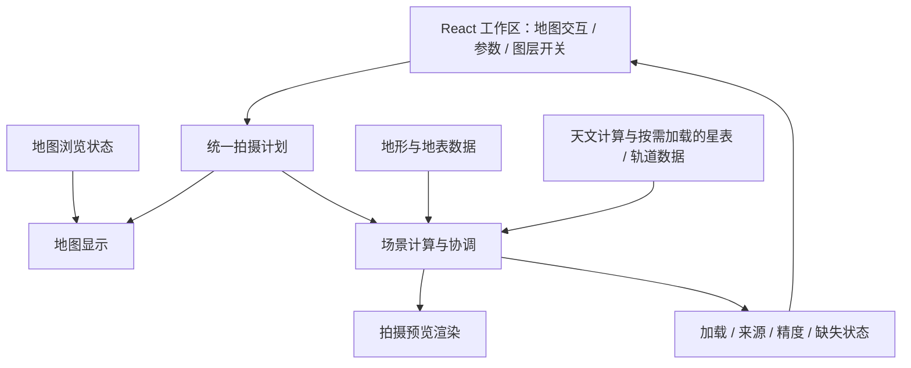

# 全局架构

状态：P2 地形与晴空环境采用 MapLibre；P3 日月、亮星、金木星、银河与深空采用本地星历/星表、参考折射与共享地形深度。空间站首步采用同源 GP 快照与 SGP4。更新：2026-11-06。

本文定义职责与约定，不是完整技术规格。产品范围见[全局规划](../plan/overview.md)，交互含义见[全局设计](../design/overview.md)。

## 1. 架构方向与技术状态

采用浏览器端优先的 React 应用。以一份拍摄计划连接地图、参数和预览，将地理数据、天文计算与具体渲染引擎分开，逐步接入能力。

| 状态 | 内容 |
| --- | --- |
| 已确定 | React 界面；地图、预览、参数与图层侧栏；开源地图引擎；统一拍摄计划；按阶段增量实现 |
| 当前采用 | TypeScript + Vite；React 内置状态；Temporal polyfill；地图和独立三维预览采用 MapLibre GL JS；Mapterhorn DEM 与 OpenFreeMap 水体边界；Astronomy Engine 本地计算天体方向，HYG 亮星子集、OpenNGC 深空子集与轮廓、CelesTrak 静态轨道快照与 satellite.js 7.1.0 |
| 后续可选 | 极区、独立水平水面或更高精度三维需求出现时，再评估 CesiumJS 或其他渲染器，不在本轮增加第二套引擎 |
| 待验证 | 近地与长焦实景构图精度、极区覆盖、实际 GPU 性能和水面高程；远端定时轨道更新运行记录、深空外观光度与真实星空可见度 |
| 暂不引入 | 专用后端、数据库、账户服务、通用插件系统、云端渲染 |

P2 首步采用 MapLibre 地形与第一人称相机能力，复用已有引擎、Worker 和参数模型。以自动检查验证几何与状态流，实际视觉与精度仍需浏览器验收。参见 [MapLibre 文档](https://maplibre.org/maplibre-gl-js/docs/)、[地形示例](https://maplibre.org/maplibre-gl-js/docs/examples/3d-terrain/)、[第一人称示例](https://maplibre.org/maplibre-gl-js/docs/examples/walk-around-a-map-in-first-person/)（查阅：2026-11-04）。

## 2. 概念模块与数据流

| 概念模块 | 职责 | 边界 |
| --- | --- | --- |
| 工作区界面 | 布局、输入、图层选择与状态反馈 | 不在 React 组件中散落天文算法或数据源细节 |
| 拍摄计划 | 保存机位、拍摄方向、时间、镜头与图层选择；对外以带版本的机位格式保存与分享 | 不存渲染器实例、瓦片内容或逐帧中间结果 |
| 地图适配 | 将机位和水平视场映射到地图，接收选点与方向操作 | 地图平移、缩放不自动等于改变拍摄计划 |
| 场景计算 | 根据统一输入计算视场、地面与天空所需信息 | 相同输入和相同数据版本产生可复现的场景 |
| 预览渲染 | 从摄影机位显示地面、天空及已接入图层 | 引擎相机参数必须转换为项目统一约定 |
| 数据适配 | 按需加载地理、星表、轨道等数据，返回来源与可用状态 | 服务地址、认证和数据格式不渗入业务界面 |

这里的模块是职责划分，不要求立即建立对应目录、抽象接口或服务。先用小规模实现验证边界，再在确有替换或复杂度需要时提取。

工作区的右栏折叠状态与定位请求由 React 界面保存，与拍摄计划分开。地图与预览的左右顺序、宽度比例和窄屏标签同样只属于界面状态；对调只改变 CSS 排列，不重新挂载地图或预览。预览把地面高程回传给工作区，供地图下方的机位条显示。图层分组的初始展开状态取自当时的图层开关，之后左栏开关发出带展开/折叠标记的定位请求，不移动焦点；滚动在展开内容提交后进行，信息栏隐藏时延后到其获得尺寸，期间关闭图层会撤销待定位。预览继续共享既有场景计算，将分组读数通过现有 portal 输出到右栏。地形通过结构化回调向预览信息条提供高程、实际相机与等待状态，保留最后一次有效画布，持续等待才显示加载反馈。画幅和容器尺寸变更在应用摄影姿态前同步渲染器尺寸。详见[工作区调整](../plan/workspace-ui.md)。

机位格式是拍摄计划的对外表示：`src/domain/shot.ts` 负责编解码、校验与分享码，读取函数穷举计划全部字段；`src/domain/shot-library.ts` 读写浏览器本地存储中的机位库与会话，存储以参数注入便于测试不可用、配额不足与损坏。应用机位整体替换计划、关联机位与各参数输入框的草稿，并发出右栏同步请求；会话在计划变化后 300 ms 写入、页面隐藏时补写。构图线、面板布局和地图浏览状态不进入机位。详见[机位保存与分享](../plan/shot-presets.md)。

推算（第一轮“找时间”）的求解器在 `src/domain/alignment.ts`，为不依赖 DOM 的纯函数：期望位置是视方位与视高度，天体位置与预览共用参考椭球观察者、`topocentric` 与折射；以期望高度的穿越和上下中天为种子，在切平面上迭代求最接近时刻。扫描可按时间段切分后合并，界面在主线程每 30 天让出一次事件循环，旧推算作废；以后需要时可原样移入 Worker 或供 AI 工具调用。

第二轮“找机位”的求解器在 `src/domain/position-alignment.ts`，DEM 以同步取样函数注入：每分钟一次星历得到天体在地心坐标中的位置，再换到候选机位自己的地平；沿目标反方位扫描并二分出距离，按视线方位修正经线收敛，最后沿眼点到目标顶部的弦检查 DEM 通视。取样函数由 `src/preview/elevation.ts` 的 `elevationTiles` 先读入对齐线经过的 z12 瓦片（单次最多 40 块、独立缓存）后提供，求解按 60 分钟一段让出事件循环。

第三轮“两者都找”的求解在 `src/domain/range-alignment.ts`：主体占比换算距离带，按高度上限预筛分钟，逐日复用找机位的求解并按实际 DEM 重算主体占比。多日计算放在模块 Worker（`src/preview/range.worker.ts`）中，分 `plan`（可用分钟、走廊、扇区）与 `solve`（带瓦片逐日求解）两步；消息处理（`range-worker.ts`）不依赖 Worker 全局对象，浏览器不支持时主线程按日分段。DEM 取样函数 `tileSampler` 在 `src/domain/terrain.ts`，两边共用。

第十轮起三种求法统一为构图约束搜索（`src/domain/composition.ts`）：目标（地面点或天体，各带画面位置与容差）、搜索范围与筛选组成条件，`classify` 判断能求出什么并选择求解器——地面点加天体且机位不固定时用找机位的求解器（`PairFrames` 把两者的画面位置差按俯仰换算成方位差与高度差，底部位置按实际投影检查），机位固定时由地面点或固定朝向定出天体方向后用找时间的求解器，两个天体时按分钟扫描相对画面位置。`aimAt` 是 `frameDirection` 的逆，求出把某方向放到画面某处的相机朝向；`tryPatch` 统一写出试看字段。筛选先在目标处带余量预筛分钟（`Prefilter`），求解后逐分钟精确检查。第十一轮起最多 4 个目标：主约束以外的目标由 `extraGap` 按试看朝向逐分钟检查；画面两点的夹角与朝向无关，机位线搜索前按其余天体与主天体的角距预筛（`prefilterOf`）。星空可见性在求解后按机位读取光污染，与月光、自然天光合成天顶亮度（`zenithBrightness`）。第十五轮起两个地面点（没有天体）由 `src/domain/ground-pair.ts` 求机位：在搜索圆环上铺网格算第二个点的画面偏差，局部极小处用高斯—牛顿法收敛，再在视线经过的较细地形上重新收敛并检查视线；结果条目带 `place`（与时间无关），试看只写机位与朝向。推算请求 v2 在 `solve.ts`，v1 读入时按打开者镜头转换。

推算状态由 App 中的 `useComposition`（`src/components/Composition.tsx`）保存，地图、预览标记（`CompositionMarks.tsx`）、时间轴与面板共用；不进入拍摄计划、机位与会话。搜索显式触发，结果属于发起搜索时的条件快照，条件改变只标为过期。多日机位线经 `solve-runner.ts` 交给模块 Worker。面板经 portal 输出到右栏，时间轴通过 `extraEvents` 接收“对齐”刻度，地图用独立 GeoJSON 源画地面点、范围与结果线。试看只经同一 `update` 修改拍摄计划。详见[构图约束搜索](../plan/composition-search.md)。

推算请求是推算条件的对外表示（`src/domain/solve.ts`，格式 `tamatamatori.solve` v1），与机位格式并列：请求只描述意图，数值总在本机求解，求出的结果经试看成为普通机位，因此机位格式不加意图字段。`solvePlan` 给出载入后的计划，`solveRequestOf` 把面板状态写回请求，`useAlignment.load` 写入面板状态。App 在载入与 hash 改变时读取 `#shot=`、`#solve=`，经预览确认后才改计划，关闭预览即以 `history.replaceState` 清除 hash；hash 不发送给服务器。链接与 `$schema` 按页面自身地址生成（`src/domain/site.ts`）。对外说明 `public/llms.txt`、两份格式说明与 JSON Schema 由 `scripts/formats.mjs` 按代码常量生成，构建时校验不漂移；应用解析器仍是格式的权威，schema 只镜像其规则。

推算结果的落地（第六轮）只在界面层组合纯函数：`pointPlan` 给出试看写入的字段，找机位、两者都找与日历链接共用；`solve-calendar.ts` 生成 RFC 5545 文本（UTC、75 字节折行、转义）；`mergeCandidates` 与 `distinctPoints` 合并同一视线上的近似重根。“存为机位”由 App 持有的机位库实例保存；同一页面的多个 `useShotLibrary` 实例在写入后经本地事件重读存储，避免旧列表覆盖新机位。

固定方向天体（第八轮）由 `src/domain/sky-targets.ts` 从星表与深空目录生成并登记到 `sky-coordinates.ts`；求解器只经后者把天体换成 astronomy-engine 的自定义恒星，因此两者都找的 Worker 不带目录，由规划消息登记所需天体。天暗判断用 `Date` 计算的太阳高度，避免 Worker 引入 Temporal。

“检查机位”（第七轮）按需运行：`src/domain/feasibility.ts` 只做几何判断（点在带洞多边形内、射线与轮廓求交、含曲率视线高度、按瓦片上限截取对象），`src/preview/feasibility.ts` 读取与预览同源的 OpenFreeMap z14 矢量瓦片，只解码 `water` 与 `building` 并按页面缓存。建筑基底取推算用的 DEM 采样器。检查结果由推算面板持有，按列出的机位与离地高度判定是否仍然有效，不进入拍摄计划、导出或地图。

当地光污染开关属于拍摄计划，固定图集按经纬度异步采样，数据状态与天文几何分开。CPU 读数与 GPU 显示共用同一天空对比度计算，数据更新不重建地形或重新获取 DEM。静态数据、许可与显示近似边界见[光污染首步](../plan/light-pollution.md)。

天气使用 Open-Meteo 七天 UTC 小时序列，按机位与所选模型按需请求，客户端缓存 30 分钟与最多四个机位/模型组合。天气状态与拍摄计划分开，云层在既有日月自定义图层末尾合成，使用实际摄影相机射线与 DEM 天空深度。CPU 标记与 GPU 云层采用一致的方向覆盖模型，降水合成到前景。标注保留的方向遮挡状态与当前视场测量状态分开，转向重投影，新观测条件清空。时效、缺测与标注连续性见[天气首步](../plan/weather.md)和[环境优化](../plan/environment-refinement.md)。

低、中、高云的示意距离、尺度、透光和云形参数集中维护，CPU 采样与生成的 GLSL 共用，按远近合成并在地平线平滑收敛。雨雪使用独立播放时钟和有界重绘定时器，宿主可见性、页面可见性与减少动态偏好共同控制暂停，资源随图层卸载释放。逐帧复用已准备的天气与光照数据。

建筑首步按机位读取有限范围 MVT，以公开自定义图层复用摄影 ENU 与对数主深度，数据与网格预算独立于 DEM。建筑数据变化使旧标注遮挡失效，纯转向和调焦复用几何；失败保留地形并明确建筑遮挡未知。实现边界见[建筑架构](buildings.md)。

P1 首步仅建立工作区组件与少量可测试的领域函数。布局状态（分区比例、面板位置、窄屏当前标签）与拍摄计划分开，布局调整保留时间、机位和镜头。该阶段的示意地图与示意取景用于验证方向和视场联动。

P1 第二步替换示意地图，接入真实底图、可拖动机位、方向把手与 GeoJSON 水平视场。地图实例按需加载，浏览范围在工作区单独保留；详见[地图接入设计](map-integration.md)。预览区继续保留示意标记。

P1 交互完善阶段增加地图与预览的连续手势联动。地图几何更新合并到动画帧，浏览状态增加地图旋转角；默认空白点击不改计划，放置机位使用一次性明确操作。参数扩展至 8—1000 mm 焦距、横竖幅和当地日期内的时间滑杆。

P2 首步以 DEM 三维场景替换预览平面，独立获取机位高程，再按摄影视场定位相机。水体边界贴附 DEM 表面，明确显示高度近似与无独立水位校准的限制。模块与数据流详见[山体与水体预览](terrain-preview.md)。

P2 时间天空由机位与 UTC 驱动天空、雾、地表配色与坡面阴影。通过现有实例的样式接口更新环境，时间修改不重建预览、不重新取高程或移动相机；算法、误差与范围见[时间天空设计](time-sky.md)。

P3 日月接入 Astronomy Engine 后，太阳位置与基础环境统一算法。日月开关和折射模型属于拍摄计划；圆盘及月相按同一摄影相机的三维针孔模型投影，再由公开的 MapLibre 自定义三维图层共享地形深度。异步 GPU 查询区分当前 DEM 的无遮挡、部分遮挡和完全遮挡，数据更新使旧结果失效；不新增通用图层框架。详见[日月设计](sun-moon.md)与[遮挡和折射设计](occlusion-refraction.md)。日食与月食不新增数据源：本地食况用 Astronomy Engine，中心食带与地影几何在 `src/domain/eclipses.ts`、`src/domain/eclipse-geometry.ts` 自行计算；日月位置带出遮挡比例与等效太阳高度，各明暗模型共用，见[日食与月食](../plan/eclipses.md)。潮汐读取 Open-Meteo Marine（`src/preview/tides.ts`），极光读取 NOAA SWPC（`src/preview/aurora.ts`），二者都由浏览器直连、无密钥，数据在应用层读取一次，供右栏、时间轴与地图共用；模型与口径见[潮汐](../plan/tides.md)、[极光](../plan/aurora.md)。

近地相机校准已发现引擎避让可能改变实际眼点和俯仰。预览读取公开绘制矩阵和相机角度，按实际姿态同步日月及读数，计划参数独立保留。开发校准器及模型精度边界见[相机校准设计](camera-calibration.md)。

独立 WGS84 ECEF → ENU 对照后，默认预览已对实际地形与水体网格应用机位局部投影，使用对数主深度与日月共享遮挡。固定 SDK 的本地桥接、数值稳定性和后续天体接口见[摄影空间投影](terrain-perspective.md)；[初始曲率对照](curvature-reference.md)保留历史模型差异。

现用高程尚无可证明的统一垂直基准，不自动转换为椭球高；正式转换准入与条件原型边界见[高度基准决策](elevation-datum.md)。

远山 DEM 下载和网格覆盖采用同一屏幕细节策略，SDK 固定为 6.16.0 并在安装时应用签名校验的最小兼容修正；最高原生 DEM 仍为 z12。策略、资源限制和升级边界见[远山地形细节](terrain-detail.md)。

本轮使用 [React 内置状态](https://react.dev/reference/react/useState)、[Vite](https://vite.dev/guide/) 与 [Temporal polyfill](https://github.com/js-temporal/temporal-polyfill)（查阅：2026-11-04）；依赖版本记录于 `package.json`，可复现安装记录于 `package-lock.json`。

P3 亮星、金木星、银河与星座参考沿用实际摄影相机、参考折射与地形主深度。固定 HYG 子集本地计算位置，银河为有界解析轮廓；银心方向独立标识，数据许可和异步名称遮挡见[星空架构](starfield.md)。

## 3. 统一领域约定

| 概念 | 全局约定 |
| --- | --- |
| 地理位置 | WGS84 经度、纬度，使用明确名称；经度归一到 [-180°, 180°)，纬度在 [-90°, 90°]；引擎所需数组顺序在适配边界转换 |
| 高度 | 长度使用米；地形高程与相机离地高度分开。接入地形时必须说明高程基准，不能混用椭球高与海拔 |
| 拍摄方向 | 方位角以真北为 0°，顺时针递增；俯仰角以水平为 0°、向上为正；初期横滚固定为 0° |
| 时间 | 保存 UTC 时刻与用于展示、输入的 IANA 时区；本地日期时间必须经过显式时区转换 |
| 镜头与画幅 | 焦距和传感器尺寸使用毫米；基础模型为直线投影，先按比例裁切，再按横幅/竖幅交换有效宽高，统一计算水平、垂直视场 |
| 图层 | 记录用户显示意图；计算与加载状态单独表达，不能用开关值兼任数据可用性 |

机位变更默认保留 UTC 时刻；修改显示时区默认只改变呈现方式，用户编辑当地时间才改变实际时刻。夏令时歧义在输入转换处处理。“当地时区”是可选的跟随模式：计划仍保存解析后的 IANA 时区，另以 `followLocalZone` 标记随机位重新查询（`@photostructure/tz-lookup`，有损的本地网格，边境与海上可能不准）；固定时区不受机位影响。

时间滑杆表达一个 24 小时时段内的当地钟点（白天模式为所选日期 00:00 起，夜空类图层开启时为当晚 12:00 起），以一分钟为步长；时段、事件刻度与上一/下一事件由 `src/domain/timeline.ts` 计算；不把当地钟点简单等同于 UTC 加固定时长。沿用 Temporal 的 `disambiguation: reject` 处理夏令时缺失或重复钟点，校验失败时保留原计划并显示错误。参考 [Temporal 时区语义](https://tc39.es/proposal-temporal/docs/zoneddatetime.html)。

地图浏览相机与拍摄相机分别管理。界面展示角度的约定与引擎、天文算法内部坐标不同，需要在各自适配边界转换；更详细的坐标系与误差规范在进入相应计算目标时补充。

## 4. 预览的逐步构成

1. **摄影相机**：从机位、地形高度、相机离地高度、方向与视场建立观察关系。地图缩放级别不能替代焦距。
2. **地面**：从有来源的高程与地表信息建立可解释的地面参考；数据缺失时显式降级。选点覆盖全球不等于全球都拥有精细三维场景。
3. **基础天空**：根据机位与 UTC 时刻计算太阳位置、月亮亮面比例与几何高度，驱动昼夜、暮光和夜间月光的近似配色；不能只按固定当地钟点切换颜色。细则见[环境架构](time-sky.md)。
4. **天文图层**：把目标方向转换到同一观察坐标系并投影进视场；银河、深空天体、太阳/月亮与空间站分别逐项接入。流星雨（`src/domain/meteor-showers.ts`）由工作表数据按 J2000 太阳黄经换算辐射点与 ZHR。辐射点和示意流星复用星空图层的深度与遮挡查询；数量估算和示意抽样共用同一速率模型，按 10 分钟 UTC 网格缓存，时段为拍摄时刻所在的整晚（地方平太阳时正午到次日正午中的天文暗夜）；两者都按固定机位拍摄、再用天球旋转对齐到拍摄时刻的叠加方式取舍。示意流星只随相机朝向与焦距重建，不重建星点；流星条带与辐射点符号在着色器中按设备像素距离做抗锯齿，不依赖画布多重采样。见[流星雨计划](../plan/meteor-showers.md)。彗星（`src/domain/comet-orbit.ts`、`src/domain/comets.ts`）读取站点静态目录 `comets/catalog.json`（`src/domain/comet-catalog.ts` 校验，开启图层时由 `useCometCatalog` 读取）。目录与空间站快照一样由 CI 定时增量更新并随站点发布：`scripts/update-comets.mjs` 只重新处理观测窗口未结束的回归，2 小时冷却（定时任务每 3 小时一次），失败保留原目录并暂停。界面层算出彗星场景后经 `TerrainScene` 交给星空图层。计算上，JPL Horizons 近日点密切根数按普适变量二体传播，计入光行时与测站视差；COBS 目视星等拟合的近日点前/后亮度定律给出星等，Kammerer 经验公式给出彗尾物理长度。离子尾沿太阳风相对彗星的方向伸直，尘埃尾取同动力曲线（β = 0.5），两者以三维点列投影为天球方向的条带，在星空图层中与地形共享深度；网格只随地点、时刻、折射和光污染重建，转动与变焦不重建。见[彗星计划](../plan/comets.md)。

地形遮挡、几何地平线判断、目标亮度与真实成像可见性是不同层次。尚未具备的能力以状态说明，不用视觉效果代替计算结论。

## 5. 外部数据与运行边界

开源引擎不会自动提供无限免费、覆盖全球的地形和地图服务。底图、DEM、地表纹理、星表和轨道数据需要分别确定来源、许可、覆盖、更新方式与访问限制。

OpenStreetMap 公共标准瓦片服务有署名、缓存和访问限制，也不承诺服务等级；因此数据源应可替换，不能把公共端点当作产品容量保证。详见 [OSMF 瓦片使用政策](https://operations.osmfoundation.org/policies/tiles/)（查阅：2026-11-04）。这不构成本项目已选定 OSM 公共瓦片作为生产数据源。

- 初期在浏览器中完成状态管理和轻量计算；重计算出现实际性能问题后再评估 Worker。
- 数据加载按地点、时间和图层需求触发；请求返回时检查是否仍对应最新计划，过期结果不覆盖当前画面。
- 对未变化的数据减少重复请求；缓存遵守提供方要求，不提前承诺离线地图。
- 轨道数据需保留轨道历元、获取时间及来源；预测适用范围在 P4 确定，不能只用下载时间判断可信度。
- 无外部数据时仍可编辑计划，并明确说明预览中哪些部分不可用。
- 地点搜索调用 OpenStreetMap Nominatim 公共服务（`src/preview/geocode.ts`），按其使用条款只由用户提交触发、本页请求间隔至少 1.1 秒并缓存；服务地址集中在该模块，需要时可换自建或第三方服务。浏览器定位结果只在本机使用。
- 不保存计划到云端。机位与工作状态保存在浏览器本地存储，跨设备靠分享码；需要保密凭据、受限跨域访问或服务端配额控制时，再设计最小服务端能力。

## 6. 后续决策与验证

进入某项实现前，只补充本轮所需的决策：引擎选型验证全球选点与近地视角；地形接入验证覆盖、高程基准和许可；天文接入验证坐标、时间及误差；空间站接入验证轨道新鲜度与预测限制。结论记录于本目录，避免同时锁定整套未来依赖。

实现阶段优先验证跨模块的一致性：同一机位、时间和镜头得到一致视场；跨时区或日期变更线不会错误改变时刻；焦距变化影响取景范围；缺数据、过期请求与图层关闭都得到正确反馈。精度阈值和性能预算在对应阶段建立基准后确定，本轮不作未经验证的数值承诺。

深空首步采用固定 OpenNGC 位置/角尺寸/轮廓和三分量示意 atlas，未改机与 Hα 改机仅切换发射分量响应，扩展形状共享地形深度。数据、资源边界和遮挡查询见[深空架构](deep-sky.md)。
