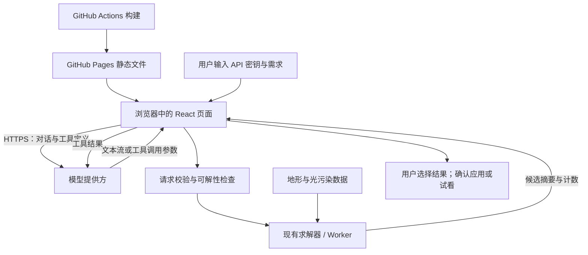

# 页面内对话（AI 第三级）评估

**当前方向已调整（2026-11-17）：用户要求 Pages 保持纯前端、无 AI 聊天；新增本地部署，由后端管理机位并调用本机 Codex／Claude Code。新评估见[双部署模式](local-deployment.md)。本文保留此前浏览器自带凭证的评估记录，不再作为当前实施建议。**

状态：2026-11-16 初评；2026-11-17 按用户要求核查“GitHub Pages 静态构建 + 用户输入凭证”的完整链路，补充官方资料与实际 API 跨域响应检查（第 8 节）。仅评估，未实施应用功能，未使用有效凭证或产生模型调用费用。更新：2026-11-17。

## 1. 结论

- **走得通：用户自己的 API 密钥，或提供方支持的授权流程**：
  - Anthropic API 允许浏览器直连；
  - OpenRouter 可粘贴 API 密钥，或经 PKCE 授权取得用户自己的密钥；
  - 同日补查 OpenAI API：官方 SDK 可显式启用浏览器，Responses／Chat Completions 预检及无效密钥响应均带跨域头，技术上也可作为提供方；官方安全建议仍是后端保管密钥，见第 8.5 节；
  - 工具在页面里执行，复用现有推算模块；
  - 不需要服务端，费用记在用户自己的账户上。
- **Claude 订阅账号（Free / Pro / Max / Ultra）的登录凭证不能用**：Anthropic 明确不允许第三方应用代为登录 claude.ai，也不允许用这些套餐的凭证替用户发请求（[法律与合规](https://code.claude.com/docs/en/legal-and-compliance)，“Authentication and credential use”一节）。
  - 订阅用户的正路是已有的 MCP 服务器：在 Claude 桌面版或 Claude Code 里接入 `scripts/mcp.mjs`（第十七轮）。
- **主要代价**：
  - 密钥要放在页面里；
  - 每次提问都花用户的钱；
  - 用户的机位与对话会发给模型提供方。
  - 这三点都能缓解，但不能消除，见第 4 节。

## 2. 现有基础

| 已有 | 页面内对话怎么用 |
| --- | --- |
| 推算请求 v2 的公开格式：`public/solve-format.md`（约 30 KB）、`solve.schema.json` | 作为模型读取的格式说明 |
| MCP 的三个工具：`solve`、`validate_request`、`describe_format` | 工具的名称、说明与返回格式可照搬 |
| `scripts/lib/solve-run.mjs` 的 `prepare`、`validation`、`resultObject` | 当前直接引用 `nodeEnvironment`，不能整份引入前端；先把纯请求处理、校验与结果整形移到 `src/domain/solve`，供三处共用，Node 加载器留在 `scripts/` |
| 页面里的推算模块：`runComposition`，在 Worker 中逐日求解 | `solve` 工具直接在浏览器运行，结果与 MCP、命令行一致 |
| `#solve=` / `#shot=` 链接：先预览，确认后才改计划，可撤销 | 模型的建议都走这个确认框，模型不能直接改计划 |
| 按需加载：推算模块首次使用时才读取 | 对话模块同样首次打开时才读取，首屏大小不变 |

## 3. 凭证与提供方

| 方式 | 浏览器直连 | 凭证从哪来 | 结论 |
| --- | --- | --- | --- |
| **Anthropic API 密钥**（用户粘贴） | 官方 SDK 显式设 `dangerouslyAllowBrowser: true`，自动添加 `anthropic-dangerous-direct-browser-access: true`（[SDK 说明](https://github.com/anthropics/anthropic-sdk-typescript#requirements)、[源码](https://github.com/anthropics/anthropic-sdk-typescript/blob/main/src/client.ts)） | 用户在 Claude Console 创建，可建专用工作区与密钥，并设月度消费上限（[工作区](https://platform.claude.com/docs/en/manage-claude/workspaces#workspace-limits)） | **可行，首选**；组织设置、额度与地域仍可能限制实际账号（[官方仓库记录](https://github.com/anthropics/anthropic-sdk-typescript/issues/703)） |
| **OpenRouter API 密钥或 PKCE 授权** | 直接输入密钥，或按官方流程用一次性授权码与 verifier 换取密钥（[OAuth 说明](https://openrouter.ai/docs/guides/overview/auth/oauth)） | 费用使用用户自己的 OpenRouter 余额；密钥仍是需要保护的凭证 | **可行，第二选项**。多经一道第三方，需另写 API 适配。支持密钥消费限额与有效期；授权页面具体能设什么仍需实际授权核对，不能把需管理密钥的接口直接搬进前端（[密钥接口](https://openrouter.ai/docs/api/api-reference/api-keys/create-keys)） |
| **OpenAI API 密钥** | 官方 SDK 可设 `dangerouslyAllowBrowser: true`；本次 Responses 和 Chat Completions 的预检／无效密钥响应均带跨域头（[SDK](https://github.com/openai/openai-node#requirements)） | 用户在 API 平台创建自己的密钥；API 与 ChatGPT 分开计费（[官方说明](https://help.openai.com/en/articles/9039756-managing-billing-for-chatgpt-and-the-api-platform)） | **技术上可行，可作为首批候选**；官方安全建议仍是不要在浏览器部署密钥，不能把 SDK 开关当作安全保证。实际有效密钥、流式工具循环待验 |
| 其他提供方／自定义兼容接口（含 Gemini） | 按提供方单独核查，不能从 SDK 的浏览器开关或兼容请求格式推断 CORS 与工具能力 | 用户粘贴 | 本次没有复核其完整链路，不作为首批已验证方案；不沿用社区报告下定论 |
| Claude 订阅登录（claude.ai） | — | — | **不可行**：条款禁止，见第 1 节 |
| 浏览器内置模型（Chrome Prompt API） | 不需要凭证 | — | 暂不可行：网页版仍为有限可用；工具调用只是计划中的后续功能；手机不支持；小模型难以写对推算请求（[Prompt API](https://developer.chrome.com/docs/ai/prompt-api)） |
| WebMCP（页面把工具交给浏览器自带的 AI） | 不需要凭证，模型由浏览器或用户的助手提供 | — | 观望：Chrome 仅源试用，规范仍在孵化，入口名称还在变。它与本项目“页面暴露推算工具”的形状一致，第一轮的工具层可直接挂上去 |

## 4. 风险与对策

### 4.1 密钥放在页面里

- **同源共享**：本站在 `https://imanity.github.io/Tamatamatori/`，与用户的 `imanity.github.io`、`suumoviz` 两个 Pages 站点同源。
  - 存进 `localStorage` 的密钥，另外两个站点的脚本也能读到。
- **依赖被篡改**：页面打包了 MapLibre 等第三方依赖，任何一个被篡改都能读到页面里的密钥。
- **对策**：
  1. **首版建议只放内存**，刷新后重新输入；不写入 `localStorage`、`sessionStorage`、IndexedDB、分享链接或日志。内存也不能防住当前页面代码／依赖被篡改后读取密钥；
  2. “口令加密后记住”先暂缓。它只能保护静置密文，解锁后当前页面仍能读到密钥，不是同源隔离或 XSS 防护。OpenRouter 还明确提醒不要将最终密钥放进浏览器存储（[官方说明](https://openrouter.ai/docs/guides/overview/auth/oauth)）；
  3. 页面可加 `<meta http-equiv="Content-Security-Policy">`，限制脚本、连接、表单等来源，并兼容现有地图与 Worker。CSP 不能让被攻陷的可信脚本安全，`frame-ancestors` 也不能经 meta 生效（[CSP](https://developer.mozilla.org/en-US/docs/Web/HTTP/Guides/CSP)、[meta 限制](https://developer.mozilla.org/en-US/docs/Web/HTTP/Reference/Headers/Content-Security-Policy/frame-ancestors)）；
  4. 界面写明：建专用工作区、设月度上限、用完可在 Console 撤销。
- 路径名、存储键名前缀不隔离同源存储；`sessionStorage` 也不是凭证保险箱（[同源存储范围](https://developer.mozilla.org/en-US/docs/Web/API/Storage_API/Storage_quotas_and_eviction_criteria)、[Web Storage](https://developer.mozilla.org/en-US/docs/Web/API/Web_Storage_API/Using_the_Web_Storage_API)）。
- 用户密钥只能在运行时输入。不放进仓库或 `VITE_` 变量，GitHub Actions Secret 也不能让打进 JS 的密钥保密。
- **更彻底的做法**：换自定义域名，与其他站点分开。这要用户配置 DNS，不在本评估范围。

### 4.2 费用

费用由用户承担。浏览器中的数值求解不产生模型费用，但每轮 API 调用都会计费，工具定义、格式说明与工具结果也占 token（[官方工具计费说明](https://platform.claude.com/docs/en/agents-and-tools/tool-use/overview#pricing)）。实际费用取决于模型、上下文、缓存和轮数；原每问价格仅为未实测假设，本次移除，不据此确定默认模型。

对策：

- 固定的系统提示与工具定义放在前面，开提示缓存；
- 每次提问限制工具调用轮数（如 8 轮）与输出上限；
- 界面显示本次对话已用的 token 与估算费用；
- 向模型只回传摘要、少量候选与总数，不回传瓦片和全部逐分钟点列；
- 可随时停止，取消网络与求解任务，停止后不再继续工具轮次；已发生的消耗不视为撤销；
- 前端预算提示不能代替提供方限额，硬性消费控制在提供方设置；页面不索取 Admin／Management 密钥。

### 4.3 隐私

- 对话内容、当前机位（坐标、时间）与推算结果会发给所选提供方，按用户与该提供方的协议保存。
- 打开对话前写明这一点，About 同步说明。
- 应用不把密钥或对话正文发给 GitHub Pages，也不上传到自有服务；它们会在用户浏览器中处理，并按上述范围发送给提供方。这不等于提供方不保存对话。

### 4.4 模型输出与提示注入

- 工具都只读或只出预览：搜索、检查、读当前计划、打开预览确认框。
  - 模型改不了计划，要用户确认；
  - 网络请求限定为登记的模型与既有数据服务，不接受模型指定任意 URL 或执行 JS；地形等读取仍会访问相应数据源。
- 回复按纯文本加少量格式显示，不插入 HTML。
  - 只有本站的 `#shot=` / `#solve=` 链接做成可点的按钮，其他网址只显示为文字。
- 地名查询（Nominatim）的结果属外部文本，作为数据交给模型，并标为“未核实”。

### 4.5 条款与许可

- **费用与条款**：
  - 用户自带密钥，费用按用户与 Anthropic（或 OpenRouter）的协议结算；
  - 本站不代付、不转售，与 Anthropic 对开发者的要求一致；
  - 页面内对话继续遵守现有数据源的非商业等许可，不扩展为数据转售。
- **请求频率**：
  - 模型触发的地名查询仍按 Nominatim 的规定，本页每秒最多 1 次；
  - 推算读取的地形瓦片与网页手动搜索相同。

## 5. 实现草案

- **入口**：页头或推算面板中的“对话”，首次打开时读取对话模块（不进首屏）。
- **设置**：
  - 提供方：第一轮只有 Anthropic；
  - 密钥：首版建议只在内存，持久化暂缓；
  - 模型：可配置，默认型号待按实际工具调用质量和费用选择；
  - 用量显示，清除密钥。
- **调用**：
  - 官方 `@anthropic-ai/sdk`（`dangerouslyAllowBrowser: true`），流式输出；
  - 思考与 effort 按选定模型能力配置，不写死为所有模型支持；
  - 在接口／模型支持时使用严格工具参数，仍经过领域校验和可解性检查；可中止。
- **工具**（在页面里执行）：

  | 工具 | 做什么 |
  | --- | --- |
  | `describe_format` | 读同源的 `solve-format.md`；或直接放进系统提示并缓存 |
  | `validate_request` | 规范化请求，列出带字段路径的问题，不联网 |
  | `solve` | 用推算模块在 Worker 中搜索，结果最多列 20 个，其余计数（同 MCP） |
  | `current_plan` | 当前机位、时间、镜头与已开图层，作为请求没写的缺省；不发送整个机位库 |
  | `propose` | 打开现有的 `#solve=` 或 `#shot=` 预览确认框，由用户决定是否应用 |

- **对话状态**：只在本页内存；关页即清，不上传、不跨设备。
- **验证**：
  - 工具函数用固定输入检查，与 MCP 结果逐字比较；
  - 界面检查用替身代替 SDK，走完多轮工具调用、中止、错误与预览确认；
  - 真实接口只在用户提供密钥并同意花费时做一次冒烟检查。

## 6. 建议分步

1. **第一轮**：
   - Anthropic 密钥与五个工具，预览确认；
   - 密钥缺省只放内存，CSP，用量显示；
   - 工具核心从 `scripts/lib/solve-run.mjs` 移到 `src/domain/solve`，三处共用。
2. **第二轮**：OpenRouter 登录（PKCE）与 OpenAI 兼容适配；地名查询工具。
3. **观望**：WebMCP 与浏览器内置模型成熟后，把第一轮的工具层挂上去。

## 7. 需要用户决定

1. 是否按建议首版只在内存保存密钥，暂缓“口令加密后在本机记住”。
2. 第一轮只做 Anthropic，还是同时做 OpenRouter 登录（免复制密钥，可选多家模型）。
3. 默认模型与可选范围：需要结合实际请求质量、账号可用性与费用选择，本轮不固定。
4. 入口放在页头还是推算面板里。

## 8. 2026-11-17 完整链路复核

### 8.1 构建、请求与工具循环

| 环节 | 判断与实现边界 |
| --- | --- |
| 构建与托管 | 沿用 Vite 和 Pages，只发布静态文件；用户凭证不经过构建。[GitHub Pages 官方说明](https://docs.github.com/en/pages/getting-started-with-github-pages/what-is-github-pages) |
| 浏览器请求模型 | 由用户浏览器直接请求提供方，Pages 不转发。API 必须允许 CORS；不能通过 Pages 配置、`no-cors` 或 SDK 开关补救上游拒绝。API 密钥鉴权，不携带跨站登录 Cookie。[CORS](https://developer.mozilla.org/en-US/docs/Web/HTTP/Guides/CORS) |
| 流式回复 | 浏览器接收模型的 SSE 流并更新界面，不要求 Pages 提供流式代理；要处理断流和取消。[Anthropic 流式接口](https://platform.claude.com/docs/en/build-with-claude/streaming) |
| 工具调用 | 模型返回工具名和 JSON 参数，页面运行登记的函数，再把结果作为下一轮消息送回。这是应用执行的 client tool，不要求后端。[官方工具流程](https://platform.claude.com/docs/en/agents-and-tools/tool-use/overview) |
| 数值求解 | `runComposition` 注入现有浏览器地形、光污染加载器及 `runRange`；最多一个重搜索，结果绑定发起时计划的快照，旧任务可取消 |
| 应用结果 | 自动搜索不需逐次确认；改变当前拍摄计划由用户选择结果后进入现有预览、试看或应用路径，可返回／撤销 |

**不需要把本地 MCP 服务器放到 Pages 上。** 浏览器不能直接启动 `scripts/mcp.mjs` 的 stdio 进程；页面应复用工具形状与领域函数。网页使用 `src/ui/solve/useComposition.ts` 中已有的环境注入方式；从 `scripts/lib/solve-run.mjs` 拆出纯请求与结果处理，避免将 Node 的文件、解码与网络加载器一起打包进去。无须重写求解器或增加通用 Agent 平台。

重计算仍在用户设备上进行；页面关闭后不继续运行。模型负责理解需求和解释结果，具体方位、时刻、坐标必须来自工具；参数不足时应询问，不捏造地名坐标。

### 8.2 OpenRouter PKCE 与子路径

- 按[官方 PKCE 流程](https://openrouter.ai/docs/guides/overview/auth/oauth)，每次授权生成新的 verifier，以 S256 派生 challenge。一次性 verifier 可短暂放 `sessionStorage` 等待回调，密钥本身只留内存。
- 回调可直接使用已存在的 `https://imanity.github.io/Tamatamatori/` 加查询参数，不需服务器路由；未生成的 `/auth/callback` 直接访问会 404。
- 只接受本页有对应待完成授权的回调，交换后清理 URL 中的 code 与 verifier；取消、重复、过期回调分别处理。现有 `#shot=`／`#solve=` 保持原用途，不和授权混用。
- 用户登录发生在 OpenRouter；页面不索取密码。授权成功后得到的仍是有消费能力的密钥，PKCE 不会让网页凭证变成无风险或让订阅额度变成 API 额度。

### 8.3 实际 HTTP 检查

使用 Node `fetch` 显式携带 `Origin: https://imanity.github.io`，向公开 API 发送预检和故意无效的测试密钥。Origin 不包含 `/Tamatamatori/` 路径，每个请求上限 12 秒。没有读取环境中的用户密钥。

| 接口 | 请求 | 实际结果 |
| --- | --- | --- |
| Anthropic `/v1/messages` | OPTIONS，申请 POST 与四个业务请求头 | 200，允许 origin `*`、POST 和申请的头 |
| Anthropic `/v1/messages` | POST，无效测试密钥 | 401 `invalid x-api-key`，错误响应也允许 origin `*` |
| OpenRouter `/api/v1/chat/completions` | OPTIONS，申请 POST、Authorization、Content-Type | 204，允许 origin `*`、POST 和对应头 |
| OpenRouter `/api/v1/chat/completions` | POST，无效测试密钥 | 401 鉴权错误，错误响应也允许 origin `*` |
| OpenRouter `/api/v1/auth/keys` | OPTIONS，申请 POST 与 Content-Type | 204，允许 origin `*`、POST 和对应头 |

脱敏记录见 [transport.json](ai-chat-evidence/transport.json)。这些结果证明检查时网络可达，预检与未鉴权响应有跨域头；**Node 本身不执行浏览器 CORS 校验，这不是浏览器完整链路验收**。请求中的模型名未经过有效鉴权，不能据此证明模型存在或可用。官方浏览器支持与这些响应共同支持“方案可行”的判断，不保证任意账号、地区或网络都能用。

### 8.4 实施后仍须验收

- 替身：多轮工具调用、校验失败、无解、缺数据、取消、过期结果、应用确认与撤销；同条件数值与既有网页／MCP 一致。
- 静态构建：子路径、模块与 Worker 加载、CSP；构建产物、链接与日志不含密钥。
- 用户提供专用密钥并明确同意费用后，在实际 Pages 页面完成流式回复和“需求 → 校验 → 浏览器求解 → 模型解释 → 用户应用”一整轮，确认账号、组织、地域和模型可用。
- 验证 401／403、限流、断流、刷新清空与停止后不再调用；如实现 PKCE，再实际检查授权回调和 verifier 清理。

本次只更新评估文档与检查记录，没有修改应用代码、安装模型 SDK、提交或发布。

### 8.5 OpenAI API 补查

用户随后问及“ChatGPT 的 API”。本功能应使用 OpenAI API 的 API 密钥，不把 ChatGPT 登录 Cookie／订阅会话当作 API 凭证；ChatGPT 与 API 分开计费，部分订阅可能提供关联 API 组织的促销额度，但不改变鉴权链路（[官方计费说明](https://help.openai.com/en/articles/9039756-managing-billing-for-chatgpt-and-the-api-platform)）。

- 官方 JavaScript SDK 的浏览器支持默认关闭，可显式设 `dangerouslyAllowBrowser: true`；该开关不保护密钥。官方安全指南仍建议密钥放后端，因此“浏览器可运行”与“推荐的密钥保管架构”应分开表述。[SDK](https://github.com/openai/openai-node#requirements)、[密钥安全指南](https://help.openai.com/en/articles/5112595-best-practices-for-api-key-safety)
- 项目可使用 Responses API 的流式输出与函数调用：模型给出参数，页面执行相同的五个工具，再发送函数结果；无需把本地 MCP 暴露到网络。工具 schema 与事件协议需要单独适配，求解核心不变。[函数调用](https://developers.openai.com/api/docs/guides/function-calling)、[流式响应](https://developers.openai.com/api/docs/guides/streaming-responses)
- 同样仅以 Node `fetch`、部署 Origin 和故意无效的测试密钥检查，未使用有效凭证：

  | 接口 | OPTIONS | 无效密钥 POST |
  | --- | --- | --- |
  | `/v1/responses` | 200，允许 origin `*`、POST、Authorization 和 Content-Type | 401 `invalid_api_key`，允许 origin `*` |
  | `/v1/chat/completions` | 200，允许 origin `https://imanity.github.io`、POST 和对应头 | 401 `invalid_api_key`，允许 origin `*` |

- 记录并入 [transport.json](ai-chat-evidence/transport.json)。这些结果足以把 OpenAI 从“未核查”改为“技术上可行的候选”，不能代替有效账号下的真实浏览器、流式回复和完整工具循环验收。测试使用的模型名故意无效，不能用于确认模型可用。
- 保持用户密钥仅在内存、限制工具与调用轮数、用量显示及用户选择后应用结果的建议；不需要为支持 OpenAI 增加自有后端，但浏览器中的凭证风险仍需用户接受。

本节只补充评估，不代表已选定首批提供方或默认模型。

### 8.6 Plus 订阅与官方订阅授权的区别

用户随后询问现有 ChatGPT Plus 能否直接使用。对于本评估的“用户输入 OpenAI API 密钥”方案，API 单独计费，Plus 不包含普通 API 用量，也不属于当前 Pro／Business 的订阅 API 赠送额度计划（[Plus 说明](https://help.openai.com/en/articles/6950777-what-is-chatgpt-plus)、[API 赠送额度资格](https://help.openai.com/en/articles/20001626-api-credits-benefit-for-eligible-chatgpt-subscriptions)）。

另有不同的官方授权路径：参与的应用／网站可用 Sign in with ChatGPT，经用户单独授权后使用 Plus 等计划的适用额度，不需用户提供 API 密钥。它不是把订阅 Cookie 或 token 手动填入普通 API；官方目前说明为有限合作方，并向开源开发者提供开发文档入口（[官方订阅共享说明](https://help.openai.com/en/articles/20001542-using-your-chatgpt-plan-in-other-apps-and-sites)）。

本项目尚未接入这条路径；开源准入条件、可用接口与工具能力、纯浏览器 CORS、授权回调和 Pages 适用性均未核查。若目标是直接使用现有 Plus，应另评估官方订阅授权，不能据普通 API 的跨域检查断言已经可用，也不能概括为所有第三方应用都必须另买 API 额度。
