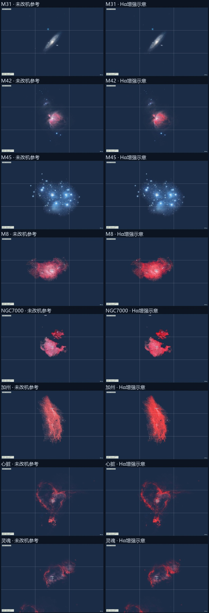

# 深空两模式色彩核查

2026-11-06。本轮核对现有八个目标的源图波段、显示颜色及未改机/改机差异，并筛选下一批可接入目标。只修正已证实的色彩问题和表述，不凭观感改造源图、不宣称器材定标，也不同时新增天体。

## 核查边界

未改机模式目前是处理后的出版图底色，不是按某款未改机相机采集或反演的影像。Hα 增强来自 RGB 的红色优势近似，不能区分 Hα、[N II]、红色连续谱、反射尘埃与源图调色。没有原始波段通量、滤镜/传感器曲线、白平衡和曝光基准，不能得出两种器材的精确颜色或固定增益。

本轮可验的是：M45 蓝色反射云不整体染红；M31 不因显示切换整体泛红；六幅星云普通模式保留源图基础红色，改机增加红光示意，不降低原有红色比例，也不改变投影和遮挡。M42 等图中的蓝色局部保留，不能把整张图单染成红色或蓝色。

佳能对 [EOS Ra 与 EOS R](https://www.usa.canon.com/learning/training-articles/training-articles-list/the-eos-ra-a-new-astrophotography-camera)给出的 Hα 波段增透示例支持“增强深红发射”的方向，但厂商对这一对机型的约四倍说明不能变成所有改机的统一增益，更不能用于将任意出版图倒推出未改机底图。

## 逐目标来源核对

下表记录源图适用性和显示方向，不是器材颜色准确性通过表。全部目标都缺少同一场景、同一曝光、成对器材的定标依据。

| 目标 | 已核实来源波段 | 两模式应保留的关系 |
| --- | --- | --- |
| M31 仙女座 | [ESA/Hubble heic1112f](https://esahubble.org/images/heic1112f/) 的 DSS2 光学 B/R 成品合成，不是相机 RGB 实拍。 | 以源图连续谱外观作参考，当前两模式保持一致；不意味真实星系内的 H II 区对改机完全无响应。 |
| M42 猎户座 | [noao-m42steinberg](https://www.astropix.org/image/noirlab/noao-m42steinberg) 光学 LRGB。 | 普通模式保留红粉色主云和蓝色局部，改机增强红光但不能把整个目标单染蓝或红。 |
| M45 昴星团 | [noao-m45denton](https://www.astropix.org/image/noirlab/noao-m45denton) 光学 RGB。 | 保留蓝色反射云；当前零红色增量，两模式保持一致，不作真实器材白平衡完全相同的承诺。 |
| M8 礁湖 | [noao-m8wideblock](https://www.astropix.org/image/noirlab/noao-m8wideblock) 光学 LRGB。 | 基础红色、暗带和源图内部星点保留；改机的额外红光不能反而降低红色比例。 |
| NGC7000 北美 | [noao-n7000mosblock](https://www.astropix.org/image/noirlab/noao-n7000mosblock) 光学 LRGB。 | 基础红粉色保留，增强限于额外红光，不对星空或银河全局染红。 |
| NGC1499 加州 | [noao-n1499block](https://www.astropix.org/image/noirlab/noao-n1499block) 光学 LRGB，说明含 Hα 与 Hβ 发射。 | 不能将“未改机”理解成只剩蓝色或没有星云；额外红光是示意，不是真实 Hα/Hβ 比值。 |
| IC1805 心脏 | [作者拼接资料](https://www.flickr.com/photos/133259498@N05/54332176110/)说明 Canon EOS 4000D / 300 mm；Stellarium 保留去星外观，滤镜响应、是否改机及去星处理没有完整定标说明。 | 底色与增强都只能作近似；不能将发布图的红色视为已验证的未改机响应。 |
| IC1848 灵魂 | 与心脏同一作者拼接资料的另一片去星纹理，未知项相同。 | 保留源图色彩关系和红光增强方向；器材准确性仍待真实波段/响应数据。 |

M31/M42 在来源清单补齐了原来缺失的波段描述；没有重采样、重调色或重新生成图集。

## 已发现的问题

旧增量色为 RGB `(1, 0.10, 0.18)`，在加红的同时加入绿、蓝。如果原像素的红色占比大于 1/1.28，增强后红色占比反而下降。对实际 PNG 取基础峰值大于 0.02、红色增量大于 0.004 的像素检查：M8 有 24643、北美有 114807、加州有 6760、心脏有 18 个像素受影响，最大红色占比下降约 0.10072；M42/灵魂没有这类像素，M31/M45 原本就没有增量。

将示意增量限制为红通道 `(1, 0, 0)`；保留底图、红色结构估计、亮度压缩、按需加载、几何与遮挡。不得用“近似模型”掩盖这一已测得的反向色偏，也不把修正后称为真实 Hα 光谱模拟。对 UI 明确标注近似参考和增强示意。

## 验收方向

- 八份来源分别核对波段与未知项，保留来源链接；出版 RGB / LRGB、DSS B/R 合成、滤镜响应未公开的 DSLR 拼接不能混称未改机实拍。
- 实际 PNG 和共享增强常量检查非减红色占比、普通底色不变、星系/反射云零增量；图集 SHA256 与此前一致。
- Chrome 固定机位、时刻、构图逐一检查两模式，特别是 M31/M45 完全不变、M42 蓝色局部保留和六星云的增强方向。保留真实截图，不能把 CPU 指标当作器材校准或 GPU 通过。
- 匹配自动测试、类型检查与子路径构建；不默认提交推送。候选目标另记录来源、许可、波段、完整覆盖、注册及纹理预算，只有核实后才列为可优先接入。

## 本地执行结果

2026-11-06 完成本轮定性色彩核查。八份来源的波段、处理方式和未知项已逐一记录；器材定标仍未完成，不将本轮通过解释为真实相机颜色正确。

- `npm test`：158/158 通过，新增实际 PNG 的红色占比回归；`npm run build -- --base /Tamatamatori/` 通过，包含 TypeScript 检查，保留已有大 chunk 提示。
- [像素报告](deep-sky-colour-evidence/pixel-audit.json)：旧公式出现反向色偏的四个目标全部归零；检查的是显示信号的红色占比，不是光谱通量。M31/M45 的额外红色分量保持零。
- 图集 4096×4096、8708911 字节，SHA256 `2e93d7c91147be4010f7172605e7579c5e37aa16368266d0ba581f2beb4ed870`，与本轮开始时完全一致。没有重调源图或改变几何。
- Chrome 刷新页面后重建固定计划，取得八目标共 16 张双模式截图及 3 张隔离对照。验收以[最终记录](deep-sky-colour-evidence/browser-results.json)中的 `fresh-` 截图为准；所有目标数据就绪、当前 DEM 未遮挡，捕获的控制台 error 为空。

固定机位为 35.4172°N、138.8729°E，离地 1.6 m，全画幅、横幅 3:2、标准折射。M31/M42/M45/加州/心脏/灵魂使用东京 2026-11-09 01:00，M8/北美使用东京 2026-07-15 22:00；逐张的方向、焦距和状态在最终记录中。加州俯仰手动设为 84.7° 保留轮廓构图。

| 目标 | 焦距 | 双模式画面核对 | 变化像素数 / 最大通道差 |
| --- | --- | --- | --- |
| M31 | 200 mm | 两模式逐像素一致 | 0 / 0 |
| M42 | 600 mm | 红粉主云保留，增强红光；蓝色局部仍存在 | 71199 / 47 |
| M45 | 600 mm | 蓝色反射云保留，两模式逐像素一致 | 0 / 0 |
| M8 | 600 mm | 基础红粉色、暗带保留，额外红光增强 | 118284 / 54 |
| NGC7000 | 200 mm | 基础红粉色保留，增强不影响整片天空 | 77715 / 58 |
| NGC1499 | 400 mm | 普通模式仍为红色云气，增强方向正确 | 138644 / 55 |
| IC1805 | 400 mm | 去星纹理形态与底色保留，红光增强 | 181109 / 65 |
| IC1848 | 400 mm | 去星纹理形态与底色保留，红光增强 | 141956 / 57 |

变化数按同一构图的预览区域逐像素比较，用于确认开关生效和应不变目标不变，不能用于量化真实改机增益。截图仅按预览区域裁切、缩放和并排排版，无色彩处理。

### 对照会话的异常与处置

首次开发会话与静态构建在 M45/M8/北美上存在差异，不能将其记为通过。保留[刷新前记录](deep-sky-colour-evidence/pre-reload-browser-results.json)和原截图；旧历史截图的跨会话比较也只保留为观察值，不能证明本轮回归。该旧会话的具体内部原因没有仪器记录，不据此推断源图或编译器有错误。

为隔离本轮公式变化，在临时目录复制当前子路径构建，只将一处 GLSL 增量色恢复为 `(1,.1,.18)`，不改工作区源文件或图集，见[对照清单](deep-sky-colour-evidence/baseline-manifest.json)。开发页完整刷新后重建相同参数，M45/M8/北美未改机预览与该静态对照全部逐像素一致（变化像素与最大通道差均为 0）；临时标签页和 HTTP 服务已关闭。验收渲染改动时应刷新会话并记录资源版本，不能只依赖热更新后的存量 GPU 状态。

## 限制与下一步

本轮修正了已证实的显示色偏，但没有取得成对的相机定标数据。特别是心脏/灵魂的源图未完整说明器材滤镜响应和后期，无法确认其基础颜色就是未改机应有的强度。源图内的星点、调色与去星处理仍是外观参考。

建议先解决满图集的新增资料驻留预算，再单独接入 M20；随后考虑 M33。来源、许可、覆盖、波段、注册和暂缓条件见[下一批候选](deep-sky-candidates.md)。本轮没有新增目录目标，没有提交、推送或部署。
