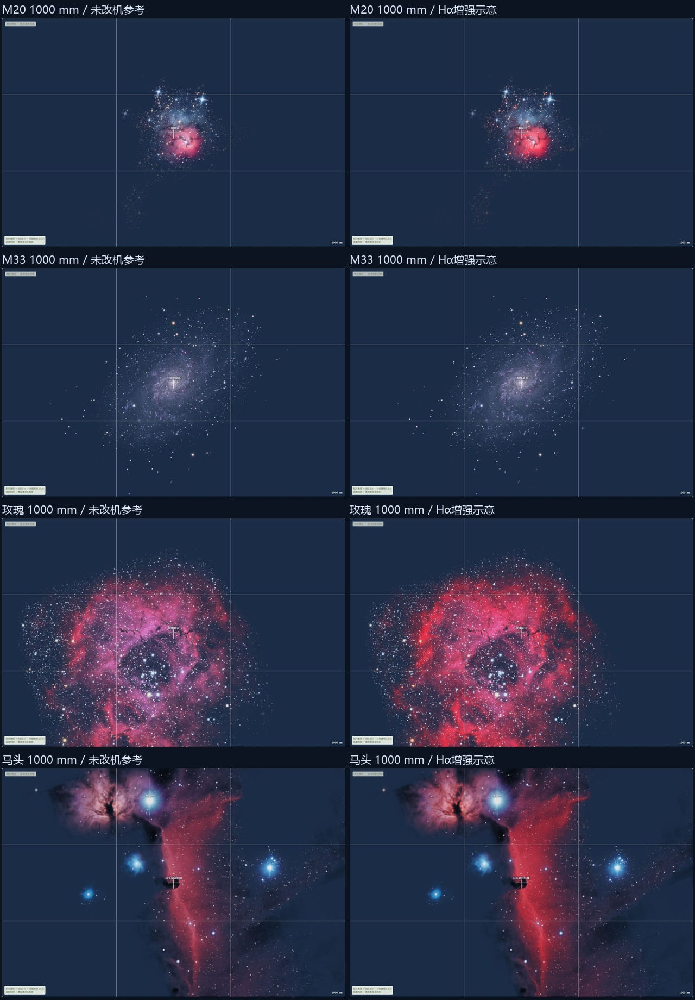
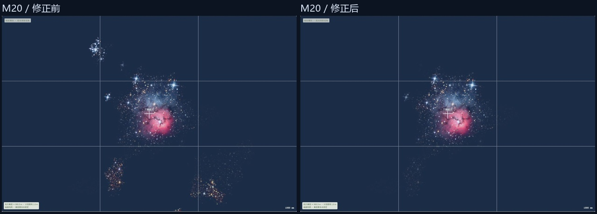

# M20、M33、玫瑰与马头接入

2026-11-06。用户要求继续实现四个目标；本轮以“新增四个有来源的深空构图参考”为一个闭环，包含所必需的纹理驻留与暗区合成，不提交、推送或部署。

## 范围与来源

- M20：NOIRLab `noao-m20johnson` 原尺寸 LRGB / AVM，保留红色发射云、蓝色反射云及暗带，支持联合红蓝扩散结构。
- M33：NOIRLab `noao-m33hotelling` 原尺寸 LRGB / AVM，保留星系连续谱与旋臂，不整体增加红色。
- 玫瑰：核对更宽且有可靠注册的资料，优先完整主要环状结构。若采用已含 Hα 的发布图，须在信息中明确，不能宣称未改机实拍底图。
- 马头：核对有许可的可见光宽幅资料，保留 IC434 背景和暗云轮廓。暗区从源图对比估计，只压暗背景合成；星表恒星独立绘制，不推断前后距离或实测光学深度。

既有八目标的像素、覆盖、颜色和分辨率保持。旧图集已满，不扩为 8192 方图，不缩小既有目标挤位置。改为当前视场内的目标分别加载，限制深空纹理驻留；远离视场、关闭、取消和卸载释放资源。单目标失败不得影响其他目标，状态与视场外、地平线下分开。

## 执行顺序与验收

1. 固定来源、许可、版本、输入哈希、波段和注册，检查主要结构覆盖。未核实的资料不能作为真实数据接入。
2. 输出独立目标纹理并保留旧像素的回归基准。按屏幕需求和设备上限选择解码分辨率，深空 RGBA/mip 预算 64 MiB（不含银河、地图和驱动开销）。预算包含当前待上传尺寸，超出时降低宽幅场景的纹理级别，不悄悄漏画。
3. 接入搜索、朝向、两模式、背景暗区合成、遮挡与逐目标加载状态；不新增曝光、器材或距离模型。
4. 运行坐标/WCS、颜色、像素与生命周期检查和子路径构建；刷新 Chrome 后检查四目标的宽幅、长焦、两模式、混合视场、地形遮挡及失败隔离，记录真实截图。数值检查不能替代 GPU 画面。

不随机生成星云结构；有限覆盖、原始分辨率、去星处理及 Hα/RGB 近似必须保留说明。源图与执行结果随实现补录，本文件不预先标记通过。

## 固定资料与实现选择

M20 使用 `noao-m20johnson` 的 1773×1388 光学 LRGB TIFF。M33 使用 `noao-m33hotelling` 的 1700×1199 光学 LRGB TIFF。两份资料按 CC BY 4.0 使用，保留 AVM 和原 RGB 高频结构，输出 2048 方形 TAN 纹理。M20 的支持同时接纳红色发射与蓝色反射结构。M33 按连续谱强度提取支持。[M20 来源](https://www.astropix.org/image/noirlab/noao-m20johnson)，[M33 来源](https://www.astropix.org/image/noirlab/noao-m33hotelling)

玫瑰采用 Kees Scherer 的 Hα+RGB 影像经 Stellarium 适配的 `n2244.png`。1024 方图覆盖主要环状结构，原许可为 CC BY-SA 4.0。马头采用 Manuel Peitsch / Sun Shuwei 的 1024 方图 `ic434.png`。作者资料为 ASI2600MC-Pro、Optolong L-Pro 可见光拼接，原许可为 CC BY 4.0。两者使用固定提交的公开四角坐标。输入文件与注册资料 SHA256 均已保存。[玫瑰来源](https://commons.wikimedia.org/wiki/File:2244_and_the_Rosette_Nebula.jpg)，[马头作者资料](https://manuel-astro.ch/project/south-of-orions-belt/)，[固定版本](https://github.com/Stellarium/stellarium/tree/230f2bd84b7827fb16be2a54c2ebdae07edf17a6/nebulae/default)

玫瑰、马头的四角 TAN 拟合最大残差为 0.643094、0.546195 源像素，两份新资料采用 1 源像素的固定验收界限。心脏、灵魂沿用 0.5 源像素界限。转换实现另用 WCSLIB 检查。拟合残差与原始摄影资料的天球精度分别记录。

马头搜索别名包括 B33、Barnard33、Horsehead Nebula 和 IC434，目录中心沿用 OpenNGC 的 IC0434，界面命名为“马头星云区域”。该朝向用于宽幅区域构图。暗区对比由源图红色优势信号的 81 像素闭运算包络与原信号的差值估计，最大背景压暗权重 0.8。最终 RGB 保留源图细节。暗区在银河之后、星表恒星之前绘制，并接受地形深度。

12 个目标逐一提供数据下载，派生 PNG 按 CC BY-SA 4.0 分发。原图作者与原许可在来源清单、预览署名区和第三方许可文件中提供。

## 画面验证中发现与修正的问题

2026-11-06 的长焦画面显示，M20 的原始颜色支持会保留主体外的零散星场块。修正使用目录中心及 28′ 全角径范围内的支持作为种子，再在既有颜色支持中做形态重建。连通的红色主云、蓝色反射区和细丝可继续向外生长。修正后，中心 0.18° 范围的 81294 个像素 RGBA 完全一致。0.5° 以外与核心的 RGB 信号总和比例从 0.215627 降至 0.006185，固定回归上限为 0.02。该指标用于显示结构回归。

修正前的三张 M20 截图及哈希清单保存在证据目录。其余 11 份独立纹理的 SHA256 与修正前一致。实际 Chrome 画面重新刷新后复核 M20 的宽幅、长焦和两模式。

新增中文资料提示在首次读取中出现编码损坏，已修正 UTF-8 清单，回归检查覆盖玫瑰的 Hα 提示和马头的暗区提示。

## 本地验收结果

2026-11-06 完成本地验收。`npm test` 为 163/163，通过独立 PNG、旧八图逐像素保留、M20 固定核心与外围信号、资源预算、取消/迟到释放、失败隔离及交互回归。子路径构建 `npm run build -- --base /Tamatamatori/` 通过，包含 TypeScript 检查，并保留已有大 chunk 提示。

WCSLIB 对 12 份资料检查 300 个转换点，最大差小于 `1e-7` 源像素。48 组独立 ERFA 方向对照的最大差约为 0.000094°。四角拟合残差仍单独保留。颜色报告中，当前红色增量导致红色占比反向下降的像素数为零。[注册检查](deep-sky-next-four-evidence/image-registration.json)，[颜色检查](deep-sky-next-four-evidence/pixel-audit.json)

Chrome 从正常界面的搜索和朝向进入场景，保留 19 张开发页截图与 3 张子路径静态构建的故障/恢复截图。固定机位为 35.4172°N、138.8729°E，离地 1.6 m，全画幅、横幅 3:2、标准折射，显示时区为东京。四目标常规场景各检查 400 mm 和 1000 mm，两种相机响应在同一构图对照。完整输入、状态与截图 SHA256 保存在记录中。[场景记录](deep-sky-next-four-evidence/browser-records.json)，[验收汇总](deep-sky-next-four-evidence/browser-results.json)

| 场景 | 观察结果 |
| --- | --- |
| M20，东京 7 月 15 日 22:00 | 红色主云、蓝色反射区和暗带保留，长焦外围星场块显著减弱。增强主要作用于红色结构。 |
| M33，东京 11 月 9 日 01:00 | 核心、旋臂和源图内部颜色可见，两模式的预览逐像素一致。 |
| 玫瑰，同上 | 主要环形结构可用，1000 mm 出现自然画框裁切，来源已含 Hα 的提示正确。 |
| 马头，同上 | 暗轮廓、IC434 发射背景和邻近参考结构可见，增强后暗轮廓仍保留。另检查了开启银河的合成。 |
| M20，7 月 16 日 02:25 / 02:45 | 分别测得部分山体遮挡和山体遮挡，中心名称隐藏，裁切由地形深度约束。 |
| M20，7 月 15 日 19:00 | 暮光下给出“天空较亮 · 轮廓隐藏”，名称隐藏。 |
| M45，11 月 9 日 01:00，600 mm | 保留蓝色反射云，两模式预览逐像素一致。 |
| 同日 8 mm 多目标视场 | 搜索列出 12 个目标，并区分画面内、视场外、地平线下，当前视场资料加载完成。 |
| 子路径构建，M31/M33 同框 | 临时静态服务只对 M33 PNG 返回 404，M33 独立报告失败，M31 保持绘制和名称。恢复该资料后关闭再开启图层，两者均恢复可用。 |

故障对照通过临时回环静态服务完成，记录中的三张截图均使用构建资产。服务已停止，正常开发服务保留。该对照验证应用的失败隔离与重试流程。[故障与恢复记录](deep-sky-next-four-evidence/failure-control.json)

## 当前资料边界

玫瑰和马头采用原生 1024 方图，高倍率细节受此分辨率和发布处理限制。玫瑰的参考色已包含 Hα 增强。两模式沿用出版配色与定性红光增量，器材色彩定标仍待专门资料。马头背景对比来自源图估计，星表恒星采用独立绘制。

12 份 PNG 压缩合计约 10.96 MiB。64 MiB 限制针对所选深空纹理的 RGBA/mip 分配，银河、地形、驱动和解码内存另计。预算策略和资源生命周期通过数值及 GL 替身检查，实际 Chrome 画面覆盖同框加载和失败恢复。

下一小步可优先核查玫瑰与马头的高分辨率、宽幅且可可靠注册的资料。
