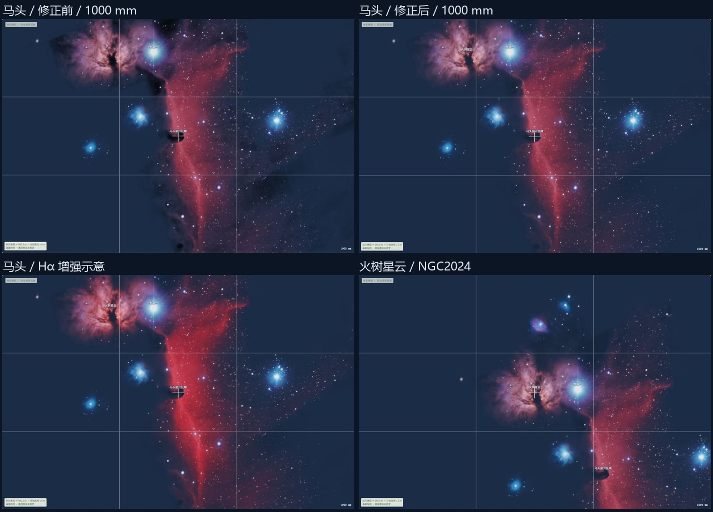

# 马头融合与火树星云

2026-11-06。用户指出马头区域与背景融合突兀，并要求支持火树星云。本轮修正背景合成，接入 NGC2024 的搜索、朝向、读数及地形遮挡，完成同区域画面闭环。

## 范围与实现

现有 IC434 可见光参考已经包含火树主体，作者说明也列出 Flame Nebula。沿用这份固定 SHA256、CC BY 4.0 许可及 Stellarium 四角注册的资料。增加固定 OpenNGC 的 NGC2024 中心、角径与别名，界面名称为“火树星云”，兼容“火焰星云”和 Flame Nebula。来源和显示限制继续保留。[作者资料](https://manuel-astro.ch/project/south-of-orions-belt/)

火树与马头共享一次影像解码、驻留和可见绘制。火树的目标范围及中心单独投影，遮挡查询在对应影像 UV 内执行，信息状态继承同一资源。共享影像的天球注册负责纹理定位，目录中心负责朝向与名称。重叠视场只绘制一次影像，沿用 64 MiB 深空纹理预算。

原马头源图暗区的最大背景压暗权重为 0.8，会把原本偏蓝的近似夜空压成独立黑块。本轮降低源图暗区对全局背景的影响，保留 RGB、源图覆盖及发射背景上的暗轮廓。暗区仍是显示对比近似，星表恒星独立。

## 验收

- 固定新目录输入哈希、独立 ERFA 方向和共享 UV 的 WCS 对照。旧十一份独立纹理及马头 RGB 保持逐像素一致。
- 检查新中文名与别名搜索、朝向、目标局部范围、单次资源加载和单次影像绘制，覆盖关闭、取消、失败及重试。
- 检查暗区权重上限、源图轮廓与两模式颜色，运行全部测试及子路径构建。
- 刷新 Chrome 后检查马头和火树的宽幅、长焦、未改机/Hα 模式、银河开关及地形遮挡，保存真实截图与资源版本。

本轮沿用现有 1024 方图，不新增曝光、器材定标、恒星消光或距离分层模型。结果随执行补录，数值检查与 GPU 画面分别记录。提交发布按用户当轮要求执行。

## 实施与本地验收结果

2026-11-06 完成本地验收。马头背景对比权重上限由 0.8 降为 0.18，保留源图暗轮廓的形状和全部 RGB 数据。PNG 8-bit 量化后的最大值约为 0.180392。源 RGB 的 SHA256 与修正前一致，其他十一幅独立 PNG 的 SHA256 也一致。覆盖、注册和额外红光计算沿用既有输入。

NGC2024 使用固定 OpenNGC 的独立中心、角径和原始轮廓。`imageReference` 指向 IC0434，局部查询网格投影回共享影像的 UV，GL 可见绘制仅执行一次。目录共 13 个目标、12 幅影像，PNG 压缩合计 11392592 字节，深空 RGBA/mip 驻留预算仍为 64 MiB。共享影像加载失败时两个目标继承同一错误状态，其他影像资源保持独立。

`npm test` 为 167/167，通过新目标搜索、共享资料及下载地址、单次解码和绘制、局部双深度查询、共享失败重试、取消释放和旧纹理保留检查。52 组 ERFA 方向的最大差约为 0.000094°。既有 12 份资料的 300 个 WCSLIB 转换点最大差约为 `5.3e-11` 源像素；火树另有 25 个独立 WCSLIB 共享 UV 点，GPU 网格 Float32 UV 对照最大差约为 `2.94e-8`，验收上限为 `1e-7` UV。转换数值与资料原始天球精度分别表达。[共享 UV 报告](horsehead-flame-evidence/shared-uv-report.json)

子路径构建 `npm run build -- --base /Tamatamatori/` 通过，包含 TypeScript 检查，保留已有大 chunk 提示。实际构建入口、代码、目录和纹理版本，以及颜色检查结果保存在汇总中。[验收汇总](horsehead-flame-evidence/browser-results.json)，[颜色检查](horsehead-flame-evidence/pixel-audit.json)

## Chrome 画面

刷新页面后，通过正常参数和搜索控件完成验证。固定机位 35.4172°N、138.8729°E，离地 1.6 m，全画幅、横幅 3:2、标准折射、东京时区。本轮保存 13 张真实截图及其 SHA256，所有记录的控制台错误数为零。[截图与输入](horsehead-flame-evidence/browser-records.json)

| 场景 | 观察结果 |
| --- | --- |
| 马头，11 月 9 日 01:00，1000 mm，未改机/Hα | 原有云气与红光模式差异保留，暗区对蓝色夜空的独立压黑痕迹减弱。 |
| 同时刻，银河开启，1000/400 mm | 两种焦距下边缘过渡可用，夜空与银河背景随现有模型合成。 |
| 火树，同日 01:00，1000 mm，未改机/Hα | 正常搜索并朝向独立中心，火树主体、暗带和名称可见，与马头共享区域影像。 |
| 火树，200 mm | 马头、火树和 M42 同框，影像加载完成，沿用现有名称避让。 |
| 火树，1 月 15 日 03:25，400 mm | 几何高度约 4.1°，当前 DEM 未遮挡。 |
| 火树，同日 03:30，400 mm | 几何高度约 3.1°，部分山体遮挡，主体由山脊裁切，中心名称仍可见。 |
| 火树，同日 03:35，400 mm | 几何高度约 2.1°，山体遮挡，主体和名称隐藏。 |
| 火树，11 月 9 日 06:30，400 mm | 天空较亮时轮廓与名称隐藏。 |
| 同日 01:00，关闭再开启深空图层 | 先显示图层关闭，再加载共享资料并恢复无遮挡状态与名称。 |

共享资源的失败和迟到取消采用 GL 替身覆盖。Chrome 验证正常加载及图层关闭重开恢复。修正前图来自上轮同机位、时刻和 1000 mm 未改机记录，原始元数据一并保留；历史取景框尺寸有整数舍入，拼图用于定性比较。RGB 逐像素保持由原始纹理的独立哈希校验确认。拼图仅裁切和缩放真实截图。[修正前记录](horsehead-flame-evidence/before-record.json)

## 后续小步

继续核查有许可、更高分辨率且能可靠注册的宽幅光学资料。当前源图为 1024 方图，长焦细节、出版配色和四角注册仍按既有资料限制表达。火树共享整片 IC434 参考，目标朝向和局部查询范围独立。背景对比与改机红色增量均为显示近似。
