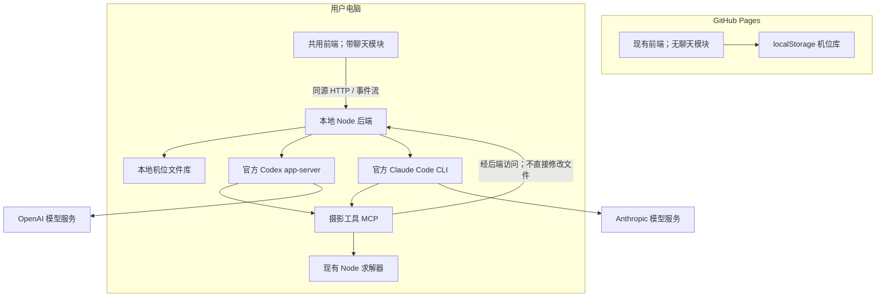

# 双部署模式：本地机位库与 AI Agent

状态：2026-11-17 用户调整方向并确认实施，见[首轮记录](#9-实施记录2026-11-17)。2026-11-18 已补齐三类聊天结果，并按用户授权完成 Codex（ChatGPT 登录）真实输出验收，见[第 10 节](#10-三类聊天结果与-codex-真实验收2026-11-18)。第 1—8 节保留实施前评估，第 9 节为首轮历史记录；Claude 原生程序仍未验。此前浏览器自带密钥的[页面内对话评估](ai-chat.md)保留为历史方案。

## 1. 结论与范围

**可行，建议按同一套前端、两种部署能力推进。** 地图、预览、求解器与公开格式继续共用；差异集中在部署入口、机位存储和本地聊天模块。

| 能力 | GitHub Pages | 本地部署 |
| --- | --- | --- |
| 地图、预览、手动推算 | 保持现状 | 共用现有代码 |
| 已保存机位 | 浏览器 localStorage | 本地后端管理的文件库 |
| 未保存的工作状态、界面偏好 | 继续保存在浏览器 | 首版也保留在浏览器，不把每次转动相机写进机位库 |
| 机位分享与导入导出 | 保留 | 使用同一公开机位格式 |
| 网页聊天 | 不提供入口，不加载 Agent 模块 | 选择本机 Codex 或 Claude Code，流式对话、调用推算工具 |
| 模型凭证 | 不需要新增凭证 | 由用户安装的官方 Agent 登录和保管 |
| 运行条件 | 静态页面 | Node 后端、前端构建产物、已安装且可登录的 Agent |

这里把用户所说的 ChatGPT Agent 具体落到 **Codex 的本机入口**；Claude 落到 **Claude Code**。不通过桌面窗口自动化、抓取 Cookie 或逆向聊天网页，也不承诺接管桌面应用中已经打开的任意对话。

本地运行的主要是界面、数据管理、Agent 程序和数值工具，模型推理仍通常访问提供方；地图、地形和天气等也继续联网。本方案不等于离线版。

## 2. 建议结构

- **本地后端同时托管前端构建和 `/api/`**，浏览器与其同源。开发时才由 Vite 转发本地 API，不改 Pages 部署成代理。
- **用构建目标明确选择能力**，不依据“是否 localhost”猜测，也不让 Pages 探测本机端口。默认构建沿用静态模式，本地构建才引用聊天与后端存储入口。
- 可用独立入口或构建时别名隔离本地模块；静态产物应没有聊天入口、Agent 依赖和 API 探测。Node 文件系统、子进程代码只在新增 `server/` 中，不进入浏览器引用图。既有 `scripts/` 不搬动。
- 拟增加本地启动命令，一次启动后端并提示本地地址；现有 `dev`、`build`、Pages CI 保留其用途。命令名、目录细节在实施时确定。
- 后端管理 Agent 生命周期和工具执行，前端只处理消息、状态、候选和用户操作，不暴露任意命令执行端点。

## 3. 本机 Agent 与订阅

### Codex

建议用官方 **Codex app-server 的 stdio 协议**接入，后端把事件转换为网页聊天流。官方定位包括嵌入应用、认证、会话、审批与流式事件；比抓终端输出更适合持续对话。SDK 或 `codex exec --json` 可作为其他入口，不作为首选聊天协议。[App Server](https://developers.openai.com/codex/app-server)、[Codex SDK](https://developers.openai.com/codex/sdk)

用户使用官方程序的 ChatGPT 登录时，消耗相应 Codex／ChatGPT 计划额度；若选择 API 密钥登录，则按 API 计费。Plus 可使用 Codex，不要求为了这条订阅路径再购买普通 API 额度，但仍受计划、账号与使用上限约束。[官方认证说明](https://developers.openai.com/codex/auth)、[计划与用量](https://help.openai.com/en/articles/11369540-using-codex-with-your-chatgpt-plan)

本地后端只检测程序、版本和登录状态，让用户沿官方登录流程完成授权；不读取、复制或自行刷新 `auth.json` 中的 token，也不修改用户全局 Agent 设置。会话由本应用创建并保存映射，不自动复用桌面当前聊天。

### Claude Code

建议后端启动用户安装的**未修改的官方 CLI**，以 `claude -p`、结构化流和明确 session id 处理对话。官方 CLI 支持流式 JSON 与按 session 恢复；需适配错误、等待输入和结束事件。[程序化运行](https://code.claude.com/docs/en/headless)、[CLI 参数](https://code.claude.com/docs/en/cli-reference)

Claude 官方规则区分两件事：第三方自行提供 claude.ai 登录、拿订阅 token 请求 API 受限制；用户本人登录未修改的 Claude Code 则有明确的保留路径。方案应让官方 CLI 自己处理支持的订阅或 API 登录，并遵守官方关于运行该程序的条件；不能宣传为通用订阅 API 或转售额度。**Claude Agent SDK 的第三方产品认证说明另要求 API 认证或事先许可，不将 SDK 直接等同于可借用订阅。**[凭证与运行条件](https://code.claude.com/docs/en/legal-and-compliance)、[Agent SDK 说明](https://code.claude.com/docs/en/agent-sdk/overview)

本机存在 API 环境变量时，CLI 的实际计费方式可能优先使用 API，必须展示检测到的认证方式，不能因为“已登录订阅”就保证这一轮不走 API。隔离子进程环境时由用户选择认证方式，不改其全局环境。[Claude 认证优先级](https://code.claude.com/docs/en/authentication#authentication-precedence)

### 共同边界

- 不在本网页索取 ChatGPT／Claude 密码、Cookie、OAuth token；未登录时提示到官方程序登录。
- 缺少某个 Agent 只使该选项不可用，不影响地图、机位库和另一 Agent。
- 每个应用聊天记录 provider 与原生 session/thread id。切换 Agent 首版开新对话；若以后传摘要承接，明确标出，不假装两家的原生会话能互换。
- 同一对话只运行一个 turn；取消需要终止该 turn、求解及必要子进程。网页断开后的任务保留策略、服务重启恢复和等待输入都要有状态，不能把子进程退出当作必然成功。
- 订阅额度不是无限使用；API 成本估计、订阅用量与剩余额度分开显示，Agent 没有提供的数据不编造。

## 4. 本地机位存储

### 现有代码的改动面

- `src/domain/shots/shot.ts` 的公开格式、校验与分享码可原样复用。
- `src/domain/shots/shot-library.ts` 目前是同步 `Storage` 读写，保存时重写整个库。
- `src/ui/shots/useShotLibrary.ts` 同步返回保存结果，多实例用本页事件和 `storage` 事件同步。
- `App`、`ShotMenu`、推算“存为机位”都依赖同步成功／失败，需要改成等待异步存储成功后更新状态。
- 地图上的机位标记已接收 `SavedShot[]`，基本可以继续使用；关键是共用同一个库状态，后端加载中不能误把当前机位判成已删除。

建议抽一个异步 `ShotRepository`，包含读取、增加、更新、改名、删除、恢复、订阅变化；由应用顶层提供单一库状态。静态适配器包装现有 localStorage，本地适配器调用 HTTP。领域校验继续共用，不把存储路径或 Agent 状态加入机位公开格式。

### 首版文件库

建议先用带版本的 JSON 库，规模不需要数据库；以后确有索引、附件或大量记录需求再换 SQLite。

- 数据放在用户数据目录，例如 Windows 的 `%LOCALAPPDATA%/Tamatamatori/`，也可显式指定目录；不默认写进代码仓库或 `public/`。
- 保留机位 id、创建／修改时间、备注和现有机位格式。库修订号属于存储元数据，不进入机位分享格式。
- 所有写入经过同一个后端服务，串行处理、临时文件替换与备份；加版本条件检测两个窗口的陈旧写入，不能后写覆盖前写。Windows 替换失败、磁盘满和恢复都要实测。
- 文件损坏时保留原件、停止覆盖并允许导出；沿用现有“不静默丢弃坏条目”的原则。
- 菜单、地图和聊天读取同一库。后端变更后通知前端刷新，不让 Agent 直接编辑库文件绕过校验、撤销和通知。

### fallback 与迁移

**fallback 按部署模式确定。** Pages 永久使用 localStorage；本地模式使用后端。后端短暂断开、写盘失败或数据损坏时明确提示，不自动转存 localStorage 并显示“保存成功”。否则同一机位库会出现两份互不相知的修改。

Pages 和 localhost 是不同 origin，本地页面不能直接读取 Pages 的 localStorage。既有分享码／JSON 可逐个导入；若要搬整库，首轮应增加整库导出／导入，预览冲突与合并后才写入。不要自动迁移、删除旧库或建立双向同步。

未保存的当前计划、布局偏好仍按浏览器会话处理；这与后端管理“已保存机位”分开。需要跨浏览器继续未保存草稿时再扩展，不影响首版可行性。

## 5. 摄影工具和网页交互

先复用已有 MCP 的 `describe_format`、`validate_request`、`solve`，数值仍来自求解器。MCP 也能隔离较重的 Node 搜索，避免堵塞后端事件流。当前 MCP 尚没有当前网页计划和机位库工具，需要补充受当前应用会话约束的桥接。

建议增加：

- 读当前计划快照、列出／读取已保存机位；
- 返回候选构图、机位或推算请求，让网页显示可应用的卡片；
- 用户选择后按现有流程应用、保存；后续若支持对话内明确指令管理机位，仍经过同一后端存储服务，批量修改先展示范围。

Agent 的结果应返回结构化机位／请求和结果标识，后端重新校验，网页直接生成卡片；不以任意模型 Markdown 链接或解析自然语言数值作为应用依据。公开分享仍可指向 Pages，当前本地页面试看使用本地状态，不把 localhost 当作他人可访问的分享地址。

用户手动改变当前计划后，旧工具结果不能自动覆盖。发给 Agent 的是明确的计划快照与被请求的机位，不默认发送整个库。原生 Agent 的登录凭证不进入页面，聊天和必要机位仍会通过 Agent 发送给模型提供方。

## 6. 必要的本地运行边界

增加的是能访问文件、启动 Agent 的本地服务，需要与普通静态开发服务区分：

- 默认仅绑定 `127.0.0.1`，校验 Host／Origin 并使用本机会话令牌；浏览器写操作和聊天流都需鉴权，不能只依赖 CORS 或“端口在本机”。不让 Pages 或任意网站启动本机 Agent。
- 后端固定可执行程序和参数模板，以参数数组及 stdin 传需求，不把用户输入拼进 shell 命令。程序与版本需检测，Windows 原生 CLI 与路径单独适配。
- Agent 使用专用工作目录和明确工具集合。已有用户 hooks、插件、其他 MCP 不能无意中全带入；隔离方案仍须保留官方登录与组织策略，不绕过它们。
- 使用受支持的工具可用性和权限配置，不能只靠提示词约束；read-only 文件沙箱也不能代替对有写能力 MCP 的权限控制。需要用户输入／审批时转回网页，未支持的请求明确结束或拒绝，不能通过全局跳过权限来消除卡住。
- CLI 子进程、MCP 子进程和重搜索的退出、崩溃、取消与资源释放都要管理，Windows 停父进程不等于已停所有子进程。
- 仅个人本机使用作为首版目标。局域网手机访问、远程托管、多用户、Docker 和完整离线不在本轮；这些并非本方案成立的前提。

## 7. 分步与验收

这是中等规模扩展，主要工作在异步存储和两家 Agent 的事件／生命周期适配，不需要重写地形或推算。

1. **双模式与本地机位库。**
   - 静态／本地入口、同源后端、异步存储适配、文件库与整库迁移；
   - 检查保存、改名、删除、撤销、刷新恢复、多个界面同步、并发冲突、断开和损坏恢复；
   - Pages 无聊天入口、无后端探测、无 Node 依赖，现有子路径构建和交互通过。
2. **Codex 本地聊天。**
   - 程序／版本／登录状态、流式会话、继续与停止、摄影 MCP、结果卡片与应用；
   - 同条件数值与现有命令行一致；用替身覆盖未安装、未登录、额度不足、权限等待、崩溃和取消；
   - 用户明确同意消耗 Agent 额度后，再用实际登录完成一轮完整链路。
3. **Claude Code。**
   - 官方 CLI 结构化流和 session 恢复，统一前端事件模型；
   - 核查实际认证方式、MCP、工具约束和权限等待；确认不会因为继承 API 环境变量误走 API；
   - 同样完成真实链路，并回归 Codex、机位库与 Pages。

安装与使用指南还应说明本地静态快照的新鲜度：空间站和彗星可以复用既有更新脚本或明确同步已发布快照，不能让陈旧快照在本地无限使用。现有过期、失败和停绘规则继续有效。

## 8. 本轮实际核查

- 已检查机位格式、同步库、React 调用方、地图标记、Node 求解器和 MCP 入口，确认能拆出部署和存储边界。
- 本机 PATH 找到 `codex.exe`，版本 `0.169.0-alpha.11.1`；`codex login status` 返回使用 ChatGPT 登录。没有读取其凭证文件或改变登录状态。
- 已检查 `app-server`、`exec` 的帮助，并离线生成协议 schema；确认有 thread 创建／恢复、turn 开始／中断及输入／审批消息。没有启动模型 turn。当前二进制为 alpha，实施时应确定支持版本并做协议探测；不硬编码桌面 App 安装目录。
- PATH 未找到 `claude`。不据此断言系统其他位置或 WSL 中没有安装；Claude 侧目前只有官方文档与代码设计核查，未本机验收。
- 简要记录见 [environment.json](local-deployment-evidence/environment.json)。完整临时 schema 留在忽略的 `.cache/`，不提交大量生成文件。
- 本轮没有安装依赖、启动本地服务、调用收费模型、修改应用代码、提交或发布。

以上为实施前核查。用户随后说“实现吧”，实施与新增验证记录如下。

## 9. 实施记录（2026-11-17）

### 使用与部署

- `npm run local` 先构建本地前端，再启动 `server/local.mjs`；打开 `http://127.0.0.1:8787/`。可传 `--port`、`--data-dir`，详见 [README](../../README.md#本地运行)。不新增 npm 依赖。
- 默认 `npm run build` 和 Pages CI 继续发布 `dist/`；本地模式用 `desktop`（Vite 保留 `local` 为环境文件后缀）输出 `dist-local/`。构建守卫拒绝静态产物包含聊天模块，CI 另检查本地构建但不发布它。Pages 不探测本机端口。
- Windows 数据默认在 `%LOCALAPPDATA%/Tamatamatori/`，包含 `shots.json`、`.bak`、`chats/` 和专用 `agent-workspace/`。未保存计划、偏好仍留浏览器。机位菜单增加整库 JSON 导出与预览合并导入；同 id 保留现有条目，导入内的重复 id 只取一次，不自动同步两个 origin。

### 文件机位库

- `server/shot-store.mjs` 管理版本、revision、进程目录锁、串行写入、临时文件同步与替换、有效旧库备份。并发窗口用旧 revision 保存会被拒绝；文件损坏时拒绝覆盖。损坏原件和 `.bak` 应在停止服务后人工检查与恢复。
- `useShotLibrary` 保留现有接口职责，变更方法改为异步；HTTP 保存成功才更新界面。多实例通过本页事件、焦点刷新和 5 秒轮询重读，不增加全局状态框架。后端失败不会降级到 localStorage 并误报成功。
- `ShotMenu`、App 与推算保存调用方均等待结果；地图继续接收同格式机位数组。领域机位格式与求解数值未变。Pages 的库也使用同一异步调用约定，底层仍同步 localStorage。

### 聊天与摄影工具

- 页头“对话”仅在本地版出现，可选择 Agent、新建或继续本应用创建的对话。SSE 显示文字与工具进度；取消、页面断开和 5 分钟上限会传递到子进程与求解 Worker。同一对话一次一轮、全局最多两个运行对话，每轮最多 40 次工具调用。
- `server/agents.mjs` 通过 Codex app-server 的 thread／turn 协议，或 Claude Code 的 `stream-json`、`--resume` 适配；文字、会话 id、错误与工具状态转换为统一网页事件。官方程序自行保管登录；不读取 token 文件。API 环境变量存在时提示可能 API 计费，首版沿用 CLI 自身认证配置，不替用户切换。
- 每轮临时 MCP 桥接提供 7 个工具：`describe_format`、`validate_request`、`solve`、`current_plan`、`list_shots`、`get_shot`、`propose`。当前计划按每次发送的快照读取，机位库按需读取；真实数值复用 `scripts/lib/solve-run.mjs` 和 `runComposition`，搜索在 Worker 中执行。
- `solve` 返回可校验机位卡片，`propose` 同样经过领域校验。卡片只有“应用试看 / 保存机位”按钮，不自动覆盖计划，也没有直接修改机位库的 Agent 工具。文字按纯文本展示，避免把模型 HTML 当作页面执行。

### 本机访问与 Agent 边界

- 服务仅监听 loopback，校验 Host、Origin 与 HttpOnly / SameSite=Strict 会话 cookie，不向 Pages 开放 CORS。MCP 每轮独立 bearer token 只可调用当前聊天的工具接口，不能持该令牌直接写 `/api/shots`。请求与输出有限额。
- 子进程以固定命令、参数数组和 stdin 启动，不拼 shell。Windows 使用原生 `.exe` 并按进程树停止；可用 `TMT_CODEX_PATH`、`TMT_CLAUDE_PATH` 显式指定路径。剔除启动 Codex 桌面聊天注入的连接环境，避免复用当前桌面工具管道。
- Codex 在命令行覆盖外部 MCP、关闭插件、hooks、apps、shell、apply_patch 与 web_search，拒绝通用审批请求；不修改用户全局配置。本机 Windows 原生 sandbox 要求 `:root` 读取权限，故使用根目录只读、禁写和禁直接网络的命名 profile，并显式排除常见凭证目录。**这不等于把全部文件读取隔离到工作区。** 本机版本仍登记 `node_repl` 内置工具；不能宣称 Agent 除摄影 MCP 外完全没有运行时能力，相关实际模型行为尚未验收。
- Claude 使用 `--restricted --tools "" --strict-mcp-config --allowedTools mcp__tamatamatori__* --permission-mode dontAsk`，要求支持这些约束的官方 CLI（2.1.248+）。本机 PATH 没有该程序，已测参数与事件协议替身，未检验原生安装、登录或订阅计费。
- 首版仍限个人本机使用；未加入局域网访问、多用户、Docker、附件、Markdown 渲染、聊天删除或订阅剩余额度查询。未知额度不编造，界面说明发送会消耗相应额度。

### 验证与待验项

- 全量自动检查 522 项通过；新增 12 项覆盖文件备份与冲突、损坏保护、目录锁、Host／Origin／会话、受限工具令牌、聊天继续与取消、真实求解 Worker、两家 Agent 协议替身、跨 UTF-8 管道分段、本地库多实例及导入去重、聊天 SSE 和纯文本渲染。
- 默认子路径 `/Tamatamatori/` 与本地构建均通过。Pages 构建守卫确认不含本地聊天包；本地包独立输出。
- 本机 Codex `0.169.0-alpha.11.1` 已完成 app-server 初始化、临时 thread 创建和摄影 MCP 工具发现；在 `turn/start` 前中止，**没有模型请求、没有额度消费**。Claude 原生链路和两家真实模型工具往返均待验，不能把协议替身当作真实 Agent 验收。
- 内置浏览器核对手机与桌面聊天布局、候选保存和应用、机位菜单、刷新后机位与聊天恢复。使用明确标为“界面测试替身”的注入适配，未伪装真实模型。截图：[桌面](local-deployment-evidence/chat-desktop.jpg)、[手机](local-deployment-evidence/chat-phone.jpg)；截图早于卡片上新增的位置核实提示。
- 本轮不重验既有地形 GPU 精度；实体手机、其他浏览器、磁盘满／断电、Windows 组织策略下的真实模型权限行为未验。测试记录见 [implementation.json](local-deployment-evidence/implementation.json)，初次只读核查仍见 [environment.json](local-deployment-evidence/environment.json)。本节记录提交前的本地验收，不代表发布后验证。

## 10. 三类聊天结果与 Codex 真实验收（2026-11-18）

用户确认补齐三类输出，并授权在本机实际调用 ChatGPT 登录的 Codex 验收。首轮仅把每个结果变成普通机位卡片，区间元数据和轨迹丢失，本轮增加内部结果协议 `src/domain/solve/chat-results.ts`，公开机位与推算格式不变：

| 类型 | 工具与界面 |
| --- | --- |
| 单个机位 | `propose.shot`，独立卡片可应用、保存 |
| 多个独立机位 | `propose.shots`，整组校验、逐个卡片、选择、分页、一次原子批量保存；任一机位无效则整组拒绝 |
| 多个区间／范围 | `solve` 保留 `ResultItem` 的起止、最佳秒、逐分钟机位、地面容差范围；聊天展示范围与滑杆，所选点可应用、保存，并直接载入现有地图、时间轴与推算控件，不重新求解 |

- 每轮新结果共用 200 个候选、10,000 个轨迹点的展示预算，超出时明确显示“显示多少 / 总数”。保留完整区间，不稀疏采样轨迹。求解默认返回 20 项、最多 200 项；按用户要求只展示少量时也说明总数。旧聊天的 `proposals` 继续可读。
- `server/solve-worker.mjs` 输出同一求解器的完整显示结果，移除不可序列化的地形取样函数；模型仍收到既有精简公开结果。界面通过同一 `tryPatch` 生成所选机位，不让模型编造区间里的位置。
- `ChatResults.tsx` 按每页 10 条显示，区间滑杆保留实际离散点，固定机位时间窗还保留起止与精确最佳秒。地图入口将完整结果载入 `useComposition.loadResults`，沿用已有线段、容差范围、时间轴、试看、返回和导出。
- 真实 Codex 首次回合发现 `current_plan` 被拒：只读权限下 MCP 默认要求审批，`never` 无法完成。现仅在本次子进程配置中为 7 个摄影工具设置 `enabled_tools` 与逐工具 `approval_mode="approve"`，其余 MCP、插件、命令、写文件和直接网络仍沿用限制，不改用户全局配置。依据[官方配置说明](https://learn.chatgpt.com/docs/config-file/config-reference)；不使用全局跳过权限。

### 本机真实验收

官方 `codex-cli 0.169.0-alpha.11.1`，ChatGPT 登录。本轮实际发起 4 个模型回合：1 次上述失败，修正后同一应用聊天内 3 次成功（包括原生 thread 恢复），不是测试替身。使用独立端口 8791 与 `.cache/chat-acceptance-data/`，未修改用户既有机位库或读取登录凭证。

1. **单机位**：“真实验收·单机位”，实际读取当前计划并提出卡片，除名称外逐字段相同；在网页保存成功。
2. **多个独立机位**：人工指定两个公开坐标与 50 / 85 mm，实际返回 2 张分组卡片，数值吻合；在网页一次批量保存，库修订号仅增加一次。
3. **多个机位区间**：2026-11-25 月亮对准晴空塔塔尖，200 mm、全画幅 3:2 横幅、离地 100 m、距塔 2—30 km。实际工具得到 7 段，按要求显示 3 段，分别为东京时区 05:32—05:58、05:59—06:08、06:09—06:54，保留 27 / 10 / 46 个点。将同一公开请求重新运行同一求解器，83 个点与元数据逐字段完全一致；这不是独立算法精度验收。
4. 第一段滑杆移到末端后，聊天保存与地图／推算滑杆均为 05:58、35.699211°N、139.840264°E、离地 100 m。地图载入 3 段、时间轴起止正确，无重新搜索。刷新后恢复 3 组结果、3 个区间与 3 个滑杆；本轮文件库共保存 4 个机位、revision 3。

534 项自动检查通过，Pages 子路径与本地构建通过；覆盖完整区间预算、来源旧结果兼容、多组展示上限、原子批量保存、选点精确秒、地图几何与时间轴载入、移动与返回。原始模型文字与精简证据见[真实对话](chat-results-evidence/codex-conversation.json)、[验收数据](chat-results-evidence/verification.json)。截图：[区间](chat-results-evidence/codex-intervals.jpg)、[多机位](chat-results-evidence/codex-multiple.jpg)、[地图与时间轴](chat-results-evidence/codex-map.jpg)。

Claude 仍只做协议替身检查；本轮不新增实体手机、跨浏览器或 GPU 构图精度验收。地图截图中的预览仍有地形待加载状态，只用于地图与交互核对，不作为天空和地标画面精度通过的证据。本节记录提交前的本机验收，不代表发布后验证。
