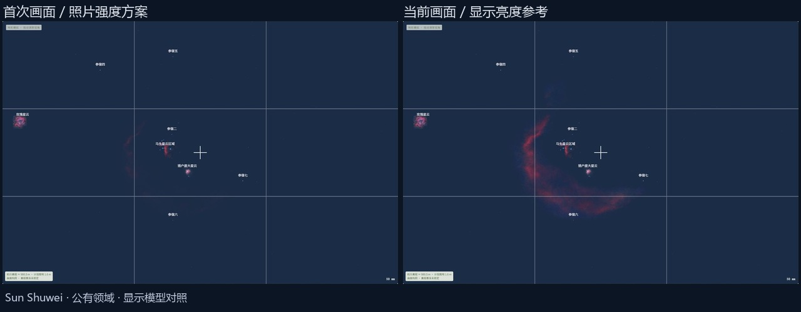
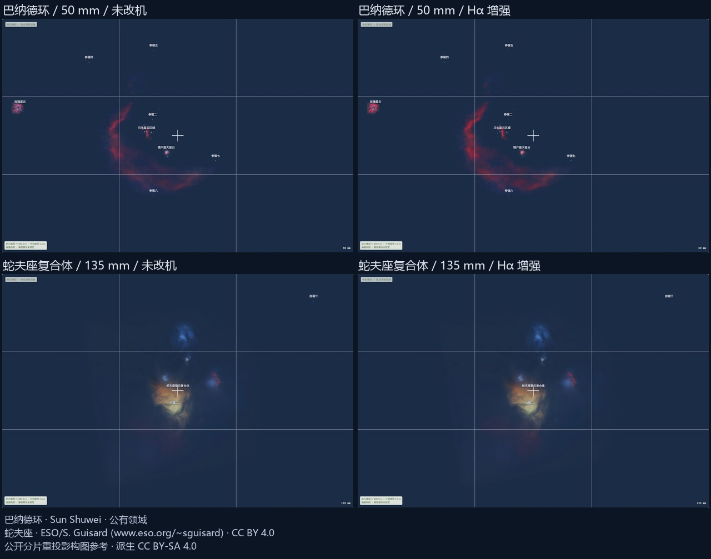

# 巴纳德环与蛇夫座星云复合体

2026-11-06。本轮按用户要求接入两个大范围深空构图参考，完成来源、注册、搜索、朝向、两模式、背景融合和地形遮挡验收。

## 资料与范围

- 巴纳德环使用固定 Stellarium 提交中的 `barnard_loop-1..4.png`，原作者 Sun Shuwei，上游 CREDITS 4.29 声明公有领域。原生分片为三幅 512 方图及一幅 256 方图，波段未单独说明。分片已保留环状云气并压低星场，避开重复叠加已有 M42 与马头主体。中心采用同一固定版本目录的 Sh2-276 事实记录，保留其输入 SHA256 与行号。
- 蛇夫座复合体使用同版本的 `rho-a00/a10/a11/a01.png`，原生为四幅 512 方图。署名 ESO/S. Guisard，原始 B/V/R 可见光拼接和上游 CREDITS 4.94 按 CC BY 4.0 使用。覆盖包含蓝色反射云、心宿二附近黄色反射云、红色云气和暗带，朝向锚点明确采用区域拼接中心。

两目标沿用分片的公开四角数值，以分片投影变换拼入统一 TAN 参考。单个四角存在非矩形形状，采用四角单应插值并记录模型。转换验证覆盖四角、内部点、接缝和最终天球投影，资料精度按公开注册的限制表达。输出 2048 纹理提供连续采样，原始分辨率在资料提示中展示。[固定版本](https://github.com/Stellarium/stellarium/tree/230f2bd84b7827fb16be2a54c2ebdae07edf17a6/nebulae/default)，[ESO 原始资料](https://www.eso.org/public/images/eso0934a/)

## 实现与验收

1. 固定八份分片、四角清单、目录记录、原许可和 SHA256，保存可重建的离线拼接步骤。拼接使用同一天球坐标，重叠像素加权归一化，内部接缝保持连续。
2. 新增两个目标及中文/英文/目录别名。采用现有独立纹理和 64 MiB 深空 RGBA/mip 预算，检查宽幅多目标场景。较大角范围沿用每段约 0.25° 的网格，上限按实际范围扩到每边 128 段。
3. 保留发布配色与定性红色增量。蛇夫座的蓝色、黄色反射云通过颜色约束排除额外红光，红色发射结构单独接受近似增强。暗带沿用源图结构对比。
4. 检查目录和搜索、固定 ERFA、分片注册及内部采样、旧纹理回归、资源与颜色，并执行全部测试和子路径构建。
5. 刷新 Chrome 后检查两目标的宽幅、局部放大、两模式、银河开关、已有猎户座目标同框、山体遮挡及关闭重开恢复，保存截图和资源版本。

本轮保持晴空构图参考的定位，原生分片与出版处理限制随界面展示，器材定标、曝光、实测消光及资料外的细节另行规划。执行结果随验收补录，提交发布按用户当轮要求执行。

## 实施结果与模型选择

2026-11-06 完成本地接入与验收。目录共 15 个目标、14 幅独立纹理。两份新参考各为 2048 方图，源分片仍按原生 256–512 px 记录。现有十二幅纹理的 SHA256 与十三个目标的中心、边界均通过固定回归。PNG 压缩合计 13315778 字节，深空 RGBA/mip 驻留预算为 64 MiB。

首轮巴纳德环采用照片线性强度方案，Chrome 中的暗部过弱。现以 `signalModel=display-rgb` 保存已处理分片的显示信号，量化后峰值红通道为 98，保留原始分片的相对配色。该选择改变显示亮度，明确用于构图参考。首次画面、当时资源哈希和同参数对照均保存。拼图使用真实截图裁切缩放。[首次资源](wide-clouds-evidence/before-resources.json)

蛇夫座采用发布的 B/V/R 外观和颜色约束。原生分片的黄色、蓝色反射结构通过 `reflection-safe` 排除额外红光，红色结构接受定性增量。实际 PNG 的 45651 个黄色样本、51021 个蓝色样本的额外红光均为零，9088 个红色样本中保留可增强结构。Chrome 两模式同构图对照中，蓝色和黄色核心示例 ROI 的像素差为零，整幅构图有 30156 个像素变化。该检查验证显示规则。[颜色及 GPU ROI 记录](wide-clouds-evidence/browser-results.json)

## 数值与构建

- `npm test` 为 170/170，包含新目标搜索、来源/许可、旧纹理与坐标、宽幅网格、黄色/蓝色保护，以及已有资源预算、失败、取消、重试、共享影像和 GL 状态检查。
- 60 组独立 ERFA 方向的最大差约为 0.000094°。14 幅影像的 350 个 WCSLIB 转换点最大差约为 `5.3e-11` 源像素，保留火树的 25 个共享 UV 对照点。
- 八份分片以独立 WCSLIB/SVD 对照 200 个内部点，最大差约为 `6.8e-12` 派生拼接像素。200 个 RGB 采样点均在 1 个码值容差内保留。此处核查四角插值与采样实现，原始恒星板解精度按资料限制表达。[分片检查](../../tests/fixtures/wide-cloud-registration.json)
- 两份派生拼接图再次生成，SHA256 与固定记录相同。[重建记录](wide-clouds-evidence/reproducibility.json)
- 子路径构建 `npm run build -- --base /Tamatamatori/` 通过，包含 TypeScript 检查，保留已有大 chunk 提示。14 幅纹理的红色增量检查中，红色占比反向下降的像素数为零。[颜色报告](wide-clouds-evidence/pixel-audit.json)

## Chrome 画面

刷新页面后使用固定机位 35.4172°N、138.8729°E，计划离地 1.6 m，全画幅、横幅 3:2、标准折射、东京时区。保存 14 张本轮验收截图及 1 张首次弱信号截图，控制台错误数为零。资源版本、全部输入、图层、状态和截图 SHA256 随记录保存。[完整记录](wide-clouds-evidence/browser-records.json)，[验收汇总](wide-clouds-evidence/browser-results.json)

| 场景 | 观察结果 |
| --- | --- |
| 巴纳德环，11 月 9 日 01:00，50 mm，未改机/Hα | 可辨认公开资料中的大弧线，与既有 M42、马头及玫瑰同框。核心区域回归确认已有 M42、马头和火树位置的环纹理为零信号。宽幅名称沿用现有避让。 |
| 同场景开启银河 | 结构随当前银河背景合成，有限覆盖的外沿过渡可用。 |
| 巴纳德环局部，135 mm | 检查跨分片的弧线、内部接缝与云气边缘，细节按原生分片表现。 |
| 巴纳德环，1 月 15 日 03:00，50 mm | 几何高度约 5.1°，显示部分山体遮挡，弧线按山脊裁切。 |
| 蛇夫座，6 月 15 日 22:00，135 mm，未改机/Hα | 蓝色、黄色云气及暗带可辨认，红色区域可增强，两种反射色保持。朝向采用公开分片的区域拼接中心。 |
| 同场景开启银河及 300 mm 局部 | 检查与银河融合、局部颜色、分片边缘与自然画框裁切。 |
| 蛇夫座，6 月 16 日 02:30，135 mm | 几何高度约 7.9°，显示部分山体遮挡，中心名称隐藏。 |
| 蛇夫座，同日 03:00，300 mm | 几何高度约 3.0°，显示山体遮挡，结构和名称隐藏。 |
| 同机位 8 mm | 超广角多目标场景加载完成，未出现星空加载错误。 |
| 关闭再开启深空图层 | 先显示图层关闭，再恢复影像、无遮挡状态与名称。恢复画面保留现有引擎避让提示，计划离地 1.6 m，实际约 1.62 m。 |

## 资料边界与下一小步

原生分片为 256–512 px，放大后的细节受此限制。巴纳德环上游波段未说明，采用显示信号的亮度参考。蛇夫座覆盖公开的 ρ 星—心宿二区域，使用区域中心作为构图锚点。公开四角只约束本次插值模型，原始恒星板解精度未知。两模式为颜色分量近似，暗带沿用源图外观。

后续优先核查更高分辨率、具有可靠天球注册与明确波段的宽幅资料，继续以固定来源和同参数画面对照推进。
